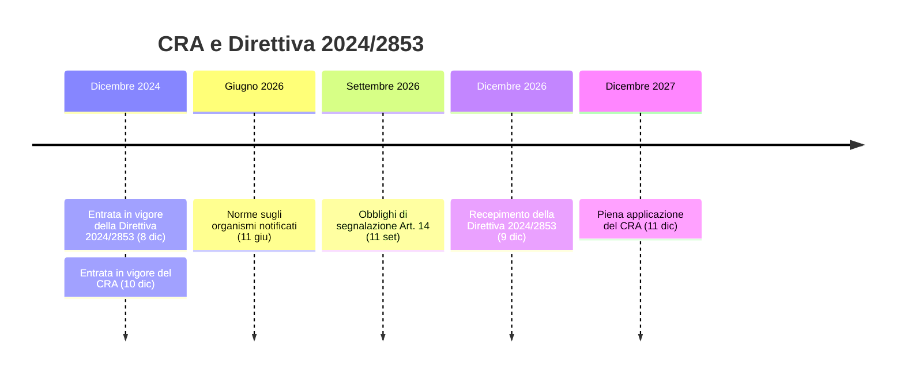
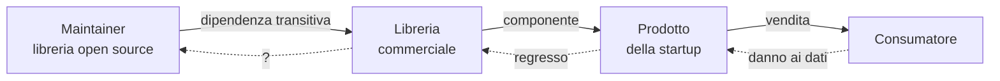

> Il software non diventerà più sicuro per decreto. Ma smetterà di essere "nessuno" il responsabile. In breve:
>
> 🇪🇺 **CRA** e **Direttiva (UE) 2024/2853**: il software è un prodotto, e chi lo vende ne risponde.
>
> 🧾 Il CRA non cambierà la sicurezza. **Cambierà la responsabilità**.
>
> 📦 La **SBOM** non è uno strumento di sicurezza: è l'ultimo baluardo contro il caos.
>
> 💾 Diventa risarcibile anche la **perdita di dati**: basta un `rm -rf` in una dipendenza.
>
> ⚠️ Il software libero non monetizzato è fuori dal CRA, ma **ne risponde chi lo integra**.
>
> 📅 Segnalazione delle vulnerabilità **dall'11 settembre 2026**, CRA pieno **dall'11 dicembre 2027**.

Qualche anno fa, con la [Direttiva RED](/post/2025-08-02-red-direttiva-europea-futuro-modding-firmware/), l'Unione Europea ha iniziato a pretendere che i dispositivi radio fossero progettati con un minimo di buonsenso: niente password `admin/admin`, aggiornamenti firmati, interfacce di debug chiuse.

Era solo l'antipasto.

Il vero piatto forte sono due testi pubblicati quasi in contemporanea a novembre 2024:

- il **Regolamento (UE) 2024/2847**, il **Cyber Resilience Act** (CRA)[^cra], che impone requisiti di cybersicurezza a *qualsiasi* prodotto con elementi digitali venduto in Europa: non solo router e telecamere, ma anche software puro, app, librerie commerciali, firmware;
- la **Direttiva (UE) 2024/2853** sulla responsabilità per danno da prodotti difettosi[^pld] (la nuova *Product Liability Directive*, PLD), che sostituisce dopo quasi quarant'anni la vecchia Direttiva 85/374/CEE e dice, finalmente nero su bianco, che **il software è un prodotto**.

Presi singolarmente, sembrano due pezzi di burocrazia europea come tanti. Letti insieme, cambiano una regola che l'informatica dà per scontata da sempre: che quando il software si rompe, **non paga nessuno**.

Proviamo allora a capire, con un po' di ordine:
- **cosa prevedono** davvero i due testi,
- **perché** il CRA da solo non renderà il software più sicuro,
- e **cosa cambia** per chi sviluppa, integra, vende o mantiene software, open source compreso.

## Il CRA in due minuti

Il Cyber Resilience Act si applica ai **prodotti con elementi digitali** messi a disposizione sul mercato europeo: hardware con software dentro, software venduto da solo, e anche le soluzioni di elaborazione remota senza cui il prodotto non funziona (il cloud della telecamera, il backend dell'app della pompa di calore). Restano fuori i settori che hanno già una regolamentazione propria (dispositivi medici, automotive, aviazione, nautica) e il SaaS puro, di cui si occupa la NIS2.

I prodotti sono divisi in categorie di rischio:

| Categoria | Esempi | Valutazione di conformità |
|---|---|---|
| **Default** (la stragrande maggioranza) | app, giochi, editor, librerie commerciali, stampanti | autovalutazione del produttore |
| **Importanti – Classe I** | browser, password manager, VPN, sistemi operativi, router, smart lock, giocattoli connessi | autovalutazione con norme armonizzate, altrimenti ente terzo |
| **Importanti – Classe II** | hypervisor, container runtime, firewall, IDS/IPS | ente terzo (organismo notificato) |
| **Critici** | smart card, gateway dei contatori intelligenti, HSM | certificazione europea |

Gli obblighi per il produttore, in sintesi:

- **sicurezza by design e by default**: nessuna vulnerabilità sfruttabile nota al momento della vendita, configurazione sicura di serie, superficie d'attacco minima;
- **gestione delle vulnerabilità** per tutto il **periodo di assistenza**, che deve durare almeno **cinque anni** (salvo prodotti con vita attesa più breve);
- **aggiornamenti di sicurezza gratuiti**, possibilmente separati da quelli funzionali;
- una **SBOM** (*Software Bill of Materials*) nella documentazione tecnica;
- **segnalazione** a CSIRT ed ENISA delle vulnerabilità attivamente sfruttate e degli incidenti gravi: *early warning* entro **24 ore**, notifica entro **72 ore**, relazione finale entro **14 giorni** dalla disponibilità della correzione;
- **marcatura CE** anche sul software.

Le sanzioni sono in stile GDPR: fino a **15 milioni di euro o il 2,5% del fatturato mondiale** per la violazione dei requisiti essenziali.

### La timeline



Un dettaglio che molti trascurano: gli obblighi di segnalazione dell'Art. 14 **valgono anche per i prodotti già sul mercato**, non solo per quelli venduti dopo dicembre 2027. Se vendi software in Europa, **sei già dentro**.

## Perché il CRA non renderà il software più sicuro

Ed eccoci alla tesi scomoda.

Il CRA chiede di vendere prodotti "senza vulnerabilità sfruttabili note". Ma le vulnerabilità che fanno davvero danni sono, per definizione, **quelle che nessuno conosceva**. Log4Shell[^log4shell] era nel codice di Log4j da anni. La backdoor di xz[^xz] è stata inserita con pazienza, in due anni di contributi apparentemente impeccabili, da qualcuno che si era guadagnato la fiducia del maintainer. Nessuna checklist, nessuna marcatura CE, nessun organismo notificato le avrebbe fermate.

Il rischio concreto è quello che chi lavora con la ISO 27001 conosce bene: il **compliance theater**. Documenti di valutazione del rischio copiati da un template, SBOM generate e mai lette, policy di *vulnerability disclosure* pubblicate e mai applicate. Quando una misura diventa un obiettivo, smette di essere una buona misura, e il CRA trasforma la sicurezza in una lista di adempimenti, con tutti gli incentivi a soddisfarli sulla carta.

E poi c'è l'autovalutazione. Per circa il 90% dei prodotti è il produttore stesso a dichiararsi conforme. Chi oggi scrive software scadente, domani scriverà software scadente **con una dichiarazione di conformità UE allegata**.

Questo non significa che il CRA sia inutile. Significa che il suo effetto principale non sarà tecnico. Sarà giuridico ed economico: per la prima volta, la sicurezza ha un **proprietario**, e quel proprietario ha un nome, un indirizzo, un fatturato.

Ed è qui che entra in gioco il secondo testo.

## La vera rivoluzione: il software è un prodotto

La vecchia direttiva del 1985 era stata pensata per elettrodomestici, automobili e farmaci. Se fosse applicabile anche al software era una questione aperta da decenni, risolta caso per caso e quasi sempre a favore di chi il software lo vendeva. Nel frattempo, ogni licenza commerciale ripeteva la stessa formula magica: *"provided AS IS, without warranty of any kind"*.

La Direttiva 2024/2853 chiude la questione:

- il **software è un prodotto**, qualunque sia la modalità di fornitura: installato, incorporato in un dispositivo, scaricato, fornito come aggiornamento, o come servizio collegato al prodotto;
- un prodotto è **difettoso** quando non offre la sicurezza che ci si può legittimamente attendere, e tra i criteri compaiono esplicitamente i **requisiti di cybersicurezza** e l'interazione con altri prodotti;
- il produttore **resta responsabile dopo la vendita** per i difetti dovuti agli aggiornamenti, o alla **mancanza di aggiornamenti di sicurezza**, finché il software è sotto il suo controllo;
- chi apporta una **modifica sostanziale** a un prodotto (anche solo via software) ne diventa il produttore;
- scompare la franchigia di 500 euro della vecchia direttiva;
- la responsabilità **non può essere esclusa per contratto**: il disclaimer "AS IS" non vale nulla davanti al consumatore danneggiato;
- se il danneggiato fatica a provare il difetto per via della complessità tecnica, il giudice può **presumerlo**. E il difetto si presume anche quando il prodotto non rispetta i requisiti obbligatori di sicurezza, cioè, nel nostro caso, **il CRA**.

Ecco il punto che sfugge nella maggior parte dei commenti: **CRA e PLD sono due metà dello stesso meccanismo**. Il CRA definisce cosa devi fare. La PLD stabilisce cosa ti succede se non l'hai fatto e qualcuno si fa male. Una violazione del CRA non costa solo una sanzione amministrativa: diventa la prova, quasi già scritta, in una causa per risarcimento.

La direttiva si applica ai prodotti immessi sul mercato **dopo il 9 dicembre 2026**, e la responsabilità dura **dieci anni** dall'immissione sul mercato.

## Basta un `rm -rf`

C'è un dettaglio della nuova direttiva che merita un paragrafo a parte: tra i danni risarcibili compare la **distruzione o il danneggiamento dei dati** non utilizzati a fini professionali.

Tradotto: le foto di famiglia, l'archivio della mail, i documenti personali. Se un software li cancella perché difettoso, chi l'ha messo sul mercato ne risponde.

Non è teoria:

- nel 2022 il maintainer di **node-ipc**[^nodeipc], una dipendenza usata da progetti molto diffusi, ha pubblicato versioni che, su macchine con IP russo o bielorusso, **sovrascrivevano i file del disco** con un cuore. L'hanno chiamato *protestware*. Per chi ha perso i dati era semplicemente un `rm -rf` con un'altra estetica;
- nel 2024 il dominio di **polyfill.io**[^polyfill] è passato di mano e ha iniziato a iniettare codice malevolo in oltre centomila siti: JavaScript che nessuno dei proprietari dei siti aveva mai letto, eseguito nel browser dei loro utenti;
- i pacchetti npm con script `postinstall` malevoli ormai non fanno più notizia: se ne scoprono di nuovi ogni settimana.

E non serve nemmeno un attaccante: nel 2015 lo script di avvio di Steam per Linux conteneva `rm -rf "$STEAMROOT/"*`. Con la variabile vuota, la riga diventava `rm -rf "/"*`, e alcuni utenti si sono visti cancellare l'intera home, dischi esterni compresi[^steam].

Prima, in tutti questi casi, la risposta era: "leggi i termini di servizio, il software è fornito *AS IS*". Da dicembre 2026, se i dati sono di una **persona fisica** e non usati a fini esclusivamente professionali, quella risposta **non basta più**.

Due precisazioni importanti:

- i dati **professionali** restano fuori: il caso CrowdStrike del luglio 2024, che ha bloccato milioni di PC aziendali, resta materia di contratti tra aziende. Ma un incidente analogo su dispositivi consumer ricadrebbe in pieno nella direttiva;
- a differenza del CRA, la Direttiva 2024/2853 **non esclude il software fornito come servizio**: il software è un prodotto indipendentemente dalla modalità di fornitura.

Ed ecco il collegamento con tutto il resto dell'articolo: il *mobile code*, il codice scaricato ed eseguito al volo come il JavaScript di polyfill.io, è esattamente il codice che **nessuno rilegge prima di eseguirlo**, ed è pieno di dipendenze di terze parti. Se una di quelle dipendenze lancia un `rm -rf` sui dati di un utente, il produttore dell'app non può dire "è colpa della libreria". La libreria è **sua**.



La catena della responsabilità risale la supply chain finché trova qualcuno che ha **messo il software sul mercato nell'ambito di un'attività commerciale**. Il maintainer volontario, di norma, è fuori. Tutti gli altri, dentro.

## La SBOM non serve per la sicurezza. Serve per sapere cosa stai usando.

Il *Software Bill of Materials* è diventato la parola magica della sicurezza della supply chain. Viene presentato come lo strumento che "protegge dagli attacchi alla supply chain", il bollino che rende un prodotto sicuro.

Non è così.

Una SBOM è una **distinta base**: un elenco, possibilmente in formato macchina (SPDX[^spdx] o CycloneDX[^cyclonedx]), dei componenti che compongono il tuo software, con versioni, fornitori, licenze e relazioni di dipendenza.

Una SBOM **non blocca nessun attacco**. Non scansiona nulla. Non dice se un componente è malevolo. È esattamente come la distinta base di un'auto: non rende i freni più affidabili, ma quando arriva il richiamo ti dice **in quali auto sono montati quei freni**.

Il problema che risolve non è la sicurezza. È **la governance**.

### Sei incidenti, lo stesso problema

Guardiamo gli incidenti di supply chain più famosi degli ultimi anni con questa lente.

- **left-pad (2016)**[^leftpad]: un maintainer rimuove da npm un pacchetto di 11 righe e mezzo ecosistema JavaScript smette di compilare. Nessuna vulnerabilità, nessun attaccante: semplicemente **nessuno sapeva di dipendere da quella roba**.
- **event-stream (2018)**[^eventstream]: il maintainer, stanco, cede il progetto a uno sconosciuto che aggiunge una dipendenza transitiva, `flatmap-stream`, con codice malevolo mirato a un wallet Bitcoin. La SBOM l'avrebbe elencata. **Non avrebbe detto che era malevola.**
- **ua-parser-js (2021)**[^uaparser]: l'account npm del maintainer viene compromesso e tre versioni pubblicate con un cryptominer e un password stealer. Chi aveva un inventario con le versioni esatte ha risposto a "siamo colpiti?" in dieci minuti. Gli altri hanno passato il weekend a fare `grep` nei `package-lock.json`.
- **Log4Shell (2021)**[^log4shell]: il caso di scuola. Log4j era ovunque, spesso **annidato dentro fat JAR, librerie shaded, appliance di terze parti**. La vulnerabilità era chiara in poche ore; capire *dove* fosse log4j ha richiesto **settimane** a moltissime aziende.
- **XZ Utils (2024)**[^xz]: una backdoor inserita dopo anni di social engineering ai danni di un maintainer esausto, nascosta nei tarball di release e non nel repository git. Nessuna SBOM l'avrebbe rilevata. Ma la SBOM ti diceva subito **quali sistemi avevano xz 5.6.0 o 5.6.1**.
- **Next.js / React Server Components (2025)**: ne ho già parlato in [un articolo dedicato](/post/2025-12-07-nextjs-vulnerabilita-startup-devops-dockerfile/). Molte startup non sapevano nemmeno di usare React Server Components, perché erano "dentro" il framework.

Il filo conduttore non è la gravità tecnica delle vulnerabilità. È che **moltissime aziende non sanno quali dipendenze finiscono in produzione**.

Non lo sanno perché:

- le dipendenze transitive sono centinaia, a volte migliaia;
- le build non sono riproducibili (ciao `npm install` nel Dockerfile di runtime: ne ho parlato a lungo nell'[articolo sui Dockerfile pericolosi](/post/2025-12-07-nextjs-vulnerabilita-startup-devops-dockerfile/));
- le immagini container includono pacchetti di sistema che nessuno ha scelto;
- i componenti vendor arrivano come binari opachi;
- "funziona, non toccare" è ancora la politica di aggiornamento più diffusa;
- ci sono ancora **script `.bat` scritti nel 2000**, mai aggiornati né riletti, che girano negli installer e nei processi di build. A volte contengono ancora gli easter egg di quando il software si distribuiva su DVD.

### L'ultimo baluardo contro il caos

> La SBOM non è uno strumento di sicurezza. È l'ultimo baluardo contro il caos.

La sicurezza viene **dopo**, da quello che fai con quell'inventario: correlare le versioni con i database di vulnerabilità, pubblicare documenti VEX per dire "sì, c'è, ma non è sfruttabile nel mio prodotto", avere una politica di aggiornamento, verificare la provenienza dei pacchetti, rendere le build riproducibili.

### La SBOM da un comando vale poco

Nelle demo dei vendor, generare una SBOM costa letteralmente un comando:

```bash
npx @cyclonedx/cyclonedx-npm --output-file sbom.cdx.json
syft ghcr.io/acme/app:1.4.2 -o spdx-json > sbom.spdx.json
grype sbom:./sbom.spdx.json
```

Esce un bel JSON, la pipeline diventa verde, la casella del CRA è spuntata. E quel JSON vale poco o nulla.

Questi strumenti leggono i **manifest**: `package-lock.json`, `packages.lock.json`, il database di `dpkg` nell'immagine. Vedono quello che un package manager ha *dichiarato*, non quello che c'è davvero dentro l'artefatto. E il punto cieco più grande sono i **runtime nativi**.

Prendiamo **LibGit2Sharp**, la libreria .NET con cui mezzo ecosistema .NET (GitVersion, tool di build, estensioni per IDE) parla con Git. LibGit2Sharp non implementa Git: è un wrapper attorno a **libgit2**, una libreria C, che arriva come DLL e `.so` precompilate dentro un altro pacchetto NuGet, `LibGit2Sharp.NativeBinaries`, nella cartella `runtimes/<rid>/native/`.

Il 6 febbraio 2024 libgit2 rilascia la 1.7.2[^libgit2], che corregge due vulnerabilità: CVE-2024-24575 (un loop infinito, quindi DoS) e **CVE-2024-24577**, una corruzione dell'heap in `git_index_add` sfruttabile con un repository costruito ad arte, **CVSS 9.8**. LibGit2Sharp 0.29, l'ultima versione disponibile, includeva libgit2 1.7.1. La versione con libgit2 1.7.2, la 0.30, arriva solo il 19 marzo[^libgit2sharp]. E ogni versione precedente alla 0.30 conteneva una libgit2 vulnerabile: chi era fermo alla 0.27 o alla 0.28, cioè moltissimi progetti, se l'è portata dietro per mesi, in molti casi senza saperlo.

Senza saperlo perché la SBOM generata dal manifest diceva:

```
LibGit2Sharp 0.27.2
LibGit2Sharp.NativeBinaries 2.0.320
```

e su NuGet nessuno dei due pacchetti risulta vulnerabile: la CVE è registrata su **libgit2**, la libreria C, non sui pacchetti .NET che la impacchettano. Lo scanner incrocia i nomi, non trova niente e risponde "tutto a posto". Per sapere quale libgit2 c'è dentro `NativeBinaries 2.0.320` devi andare a leggere il changelog. Oppure aprire la DLL.

Non è un caso isolato, è il modello di distribuzione di mezzo ecosistema:

- su **NuGet**, SkiaSharp, SQLite, librerie di crittografia e di compressione portano con sé binari nativi;
- su **npm**, i pacchetti con binari precompilati (`sharp` con libvips, i moduli `node-gyp` prebuilt) scaricano o includono librerie che nel `package-lock.json` non compaiono;
- su **PyPI**, le wheel includono copie private di OpenSSL, libwebp, libjpeg nella cartella `.libs`;
- in **Java**, i jar con dentro librerie JNI per tre sistemi operativi;
- e poi i binari **Go e Rust** linkati staticamente, il codice C copiato a mano in `vendor/` o `third_party/`, il `curl | sh` nel Dockerfile, il driver del fornitore arrivato come zip.

L'esempio da manuale è **libwebp** con CVE-2023-4863[^libwebp], nel settembre 2023: sfruttata attivamente, corretta in Chrome in pochi giorni. Ma libwebp era copiata dentro Firefox, dentro ogni app Electron (quindi Slack, Teams, Discord, VS Code), dentro Pillow, dentro SkiaSharp. Ognuno con la sua copia, ognuno con i suoi tempi di aggiornamento, e quasi nessuno visibile in una SBOM fatta leggendo i manifest.

Una SBOM che vale qualcosa richiede lavoro, non un comando:

- va **generata durante la build**, dal grafo reale di quello che viene compilato e impacchettato, non ricostruita dopo leggendo i manifest;
- deve **scendere dentro i pacchetti**: se `LibGit2Sharp.NativeBinaries` contiene libgit2 1.7.1, la SBOM deve dire `pkg:github/libgit2/libgit2@1.7.1`, come componente annidato, con il suo identificativo;
- per i binari di terze parti va **pretesa la SBOM dal fornitore**: con il CRA, se il fornitore è commerciale, deve averla;
- quello che resta va coperto con l'**analisi dei binari** (firme, stringhe di versione, hash), sapendo che sarà comunque incompleta;
- e soprattutto serve **qualcuno che la legga**: qualcuno che sappia che dietro un wrapper .NET c'è una libreria C, e che la sua CVE non verrà mai segnalata sul wrapper.

Il CRA chiede una SBOM che copra *almeno* le dipendenze di primo livello. Non va pubblicata: va tenuta nella documentazione tecnica e consegnata alle autorità su richiesta. Ma fermarsi al primo livello significa non vedere né event-stream, né xz, né libgit2. Il minimo legale non coincide con il minimo utile.

E qui il CRA mette un cronometro. Se una vulnerabilità nel tuo prodotto è attivamente sfruttata, hai **24 ore** per l'early warning. Nel dicembre 2021 molte aziende hanno impiegato settimane solo per rispondere a "ce l'ho?". Con il CRA, senza una SBOM aggiornata quelle 24 ore si passano a fare archeologia nei `.jar` dentro altri `.jar`, o nelle DLL dentro i pacchetti NuGet.

La SBOM non rende il software più sicuro. Rende possibile **sapere di cosa sei responsabile**. Ed è difficile rispondere di qualcosa che non sai di avere.

## Supply chain: ogni dipendenza è una promessa che fai tu

Un progetto web medio porta con sé centinaia, a volte migliaia, di dipendenze transitive. Ognuna scritta da qualcuno che non conosci, mantenuta (forse) nel tempo libero, aggiornata con criteri che non controlli.

Fino a oggi, `npm install` era un gesto innocente. Con il CRA, il produttore deve esercitare la **dovuta diligenza** sui componenti di terze parti, open source compreso, e deve assicurarsi che non compromettano la sicurezza del prodotto. Se trova una vulnerabilità in un componente, deve **segnalarla a chi lo mantiene** e correggerla nel proprio prodotto. E se scrive la patch, è invitato a condividerla a monte.

È un cambio di prospettiva enorme: **ogni dipendenza che aggiungi è una promessa che fai tu**, al posto di chi l'ha scritta. Non stai più "usando una libreria": ti stai assumendo la responsabilità del suo codice per i prossimi cinque anni di assistenza e i prossimi dieci di responsabilità civile.

Le conseguenze pratiche sono prevedibili:

- **meno dipendenze**, e scelte con più attenzione: la libreria da dieci righe alla left-pad diventa un rischio legale, non solo tecnico;
- **pinning delle versioni** e lockfile trattati come documenti di conformità, non come rumore nel diff;
- **build riproducibili** e firme sugli artefatti (Sigstore, SLSA), per dimostrare che quello che hai venduto è quello che hai compilato;
- **riduzione dello stack critico**: fino a ieri era normale avere nello stesso programma due librerie di compressione zip, tre client HTTP e due parser JSON, arrivati da dipendenze diverse. Fastidioso, ma accettabile. Con il CRA ogni duplicato è una superficie d'attacco in più da monitorare, una SBOM più lunga, una CVE in più da valutare entro 24 ore: per ogni funzione critica (compressione, crittografia, parsing, rete) ne deve restare **una**, scelta, aggiornata e con un responsabile;
- più **fork interni** di componenti critici, con tutti i problemi di manutenzione che ne derivano.

## Startup: la fine del "move fast and break things"

Ne ho già scritto a proposito della [vulnerabilità di Next.js](/post/2025-12-07-nextjs-vulnerabilita-startup-devops-dockerfile/): le startup sono l'ambiente dove la sicurezza è più fragile. Tempi stretti, team minuscoli, Dockerfile copiati da internet, "la sicurezza la sistemiamo dopo il lancio".

Il CRA rende quel "dopo" un problema legale. Una startup che vende un prodotto con elementi digitali in Europa dovrà:

- fare (e documentare) una **valutazione del rischio** prima di mettere il prodotto sul mercato;
- garantire **almeno cinque anni** di aggiornamenti di sicurezza: anche se tra due anni ha cambiato pivot, o non esiste più;
- avere un processo di **gestione delle vulnerabilità** funzionante, con un contatto pubblico per le segnalazioni;
- essere in grado di **notificare entro 24 ore**, anche di sabato notte.

Il regolamento qualche concessione la fa: le micro e piccole imprese non vengono sanzionate per il mancato rispetto del termine delle 24 ore, sono previsti supporto e sandbox regolamentari, e la documentazione tecnica può essere semplificata. Ma gli obblighi sostanziali restano gli stessi.

E qui il problema della PLD diventa esistenziale: una startup con un prodotto difettoso non rischia solo una multa, rischia **una class action su dieci anni di vendite**. Il che sposterà, prevedibilmente, il peso sugli investitori e sulle assicurazioni: la due diligence tecnica diventerà parte della due diligence finanziaria, e le polizze cyber chiederanno SBOM, processi e prove prima di firmare.

Non è necessariamente un male. Il "move fast and break things" funzionava perché a pagare le cose rotte erano sempre gli altri.

## Open source: dentro, fuori o nel mezzo?

Qui la preoccupazione è stata enorme. Le prime bozze del CRA rischiavano di trasformare ogni sviluppatore che pubblicava codice su GitHub in un "produttore" con obblighi di marcatura CE. La Eclipse Foundation, la Python Software Foundation, la Linux Foundation e decine di altre organizzazioni hanno lanciato l'allarme[^psf], e il testo finale è cambiato parecchio.

Oggi il quadro è questo:

- il **software libero sviluppato o fornito al di fuori di un'attività commerciale** è **fuori** sia dal CRA sia dalla PLD. Il ragazzo che mantiene una libreria nel tempo libero, accetta pull request e riceve qualche donazione non ha obblighi;
- le **donazioni senza scopo di lucro** non rendono un progetto commerciale;
- nasce una figura nuova, l'**open-source software steward**: fondazioni e organizzazioni che supportano sistematicamente lo sviluppo di software libero destinato ad attività commerciali (pensiamo ad Apache, Eclipse, Linux Foundation). Hanno un regime leggero: una policy di cybersicurezza documentata, la cooperazione con le autorità, la segnalazione delle vulnerabilità di cui vengono a conoscenza. E **non possono ricevere sanzioni pecuniarie**;
- chi **monetizza** il software (vendendolo, facendo pagare il supporto oltre il recupero dei costi, o usandolo come esca per altri servizi a pagamento) è un produttore a tutti gli effetti, licenza aperta o no.

E soprattutto, la regola chiave, scritta esplicitamente nei considerando della PLD: quando il software libero non commerciale viene **integrato da un produttore** in un prodotto commerciale, del difetto risponde **il produttore che lo ha integrato**, non chi l'ha scritto.

È una scelta sensata: non si può chiedere a un volontario di rispondere di un prodotto che non ha mai venduto. Ma ha un effetto collaterale che pochi stanno considerando: **la responsabilità scorre a valle, la pressione scorre a monte**.

Le aziende che integrano software libero, ora responsabili, inizieranno a bussare alla porta dei maintainer: per avere patch più rapide, garanzie di supporto, SBOM, firme, un processo di disclosure. Tutte richieste legittime, rivolte però a persone che **non hanno alcun obbligo** di soddisfarle e, quasi sempre, nessun compenso per farlo.

Ed è qui che il problema smette di essere giuridico e diventa economico.

## Open Source Maintenance Fee: chi paga, risponde

Il problema della sostenibilità dell'open source non è nuovo. Lo ha raccontato benissimo una vignetta di XKCD[^xkcd]: l'intera infrastruttura digitale moderna appoggiata su un piccolo progetto "mantenuto ingratamente da una persona a caso in Nebraska dal 2003". La backdoor di xz ne è stata la dimostrazione pratica: un maintainer solo, stanco, sotto pressione, che accetta l'aiuto della persona sbagliata.

Negli ultimi anni sono nati diversi tentativi di risposta: GitHub Sponsors, Open Collective, licenze *source-available*, il modello *open core*. Uno dei più interessanti è l'**Open Source Maintenance Fee**[^osmf], adottato tra gli altri dal progetto WiX Toolset: il codice sorgente resta liberamente disponibile secondo la sua licenza, ma le organizzazioni che **generano ricavi** (nel caso di WiX, oltre 10.000 dollari l'anno) sono tenute a pagare una quota di manutenzione, sotto forma di sponsorizzazione GitHub, per usare i binari ufficiali e partecipare a issue e discussioni del progetto[^wix].

È un modello onesto: chi ci guadagna contribuisce, tutti gli altri no.

Ma alla luce del CRA ha un risvolto che vale la pena guardare con attenzione. Una quota obbligatoria richiesta a chi usa il software commercialmente difficilmente può essere considerata una donazione: somiglia molto di più a una **monetizzazione**. E un progetto che monetizza entra nell'attività commerciale, con tutto quello che ne consegue: obblighi da produttore, periodo di assistenza, segnalazioni, e, con la PLD, responsabilità civile.

È un paradosso solo apparente. In realtà è il punto di equilibrio che il legislatore europeo ha disegnato, forse senza dirlo apertamente:

> **chi paga ha diritto a un responsabile; chi incassa, risponde.**

Il maintainer volontario resta libero e senza obblighi. Il maintainer che si fa pagare diventa un fornitore, con i doveri di un fornitore. E l'azienda che non paga nessuno si tiene tutta la responsabilità.

Probabilmente vedremo nascere, nei prossimi anni, un mercato che oggi esiste solo in forma embrionale: fondazioni e aziende che si fanno carico, a pagamento, della **"responsabilità come servizio"** sui componenti open source critici. Distribuzioni enterprise, steward, fork supportati. Red Hat lo fa da trent'anni con Linux; il CRA rischia di rendere quel modello la norma per qualsiasi libreria importante.

## Fraintendimenti comuni

Come con la RED, anche sul CRA circola parecchia confusione:

- ❌ **Il CRA vieta di pubblicare codice open source** → **Falso**. Il software libero non monetizzato è escluso. Pubblicare su GitHub non fa di nessuno un produttore.

- ❌ **Se uso una licenza MIT non rispondo di niente** → **Falso**, se vendi il prodotto. Il disclaimer "AS IS" protegge l'autore della libreria nei confronti di chi la usa, non te nei confronti del consumatore a cui hai venduto il prodotto che la contiene.

- ❌ **Il CRA riguarda solo l'hardware IoT** → **Falso**. Riguarda qualsiasi prodotto con elementi digitali: anche un'app, un videogioco o una libreria commerciale venduta da sola.

- ❌ **Basta generare una SBOM per essere conformi** → **Falso**. La SBOM è uno dei requisiti, non il requisito. Senza un processo che la usi, è solo un file JSON.

- ❌ **Il SaaS è coperto dal CRA** → **In gran parte falso**. Il SaaS puro ricade nella NIS2. Il CRA copre i servizi remoti solo quando sono parte integrante di un prodotto.

- ❌ **Fino al 2027 non devo fare nulla** → **Falso**. Gli obblighi di segnalazione si applicano dall'11 settembre 2026, anche ai prodotti già in commercio.

## Conclusione

Il Cyber Resilience Act non renderà il software magicamente più sicuro. I bug continueranno a esistere, le backdoor continueranno a essere inserite da chi ha pazienza, e una parte delle aziende risponderà con montagne di documenti invece che con codice migliore.

Ma insieme alla nuova direttiva sulla responsabilità da prodotto, il CRA cambia qualcosa di più profondo della sicurezza: cambia **chi paga**. Per decenni il software è stato l'unico prodotto industriale in cui il produttore poteva vendere qualcosa di difettoso, scrivere "nessuna garanzia" in una licenza e lavarsene le mani. Quell'epoca sta finendo.

Il risultato più probabile non sarà un software perfetto, ma un software **con un proprietario**: qualcuno che sa cosa c'è dentro, che si impegna ad aggiornarlo, e che ne risponde quando si rompe.

Per l'open source è una sfida e un'opportunità insieme. La sfida è che la pressione arriverà sui maintainer, che non l'hanno chiesta. L'opportunità è che, per la prima volta, le aziende avranno un incentivo economico concreto a **pagare chi mantiene il software da cui dipendono**.

E se tutto questo significa meno dipendenze installate alla cieca, meno `rm -rf` senza controlli e meno maintainer lasciati soli con il peso di mezza Internet...
...forse ne vale la pena.

📚 **Fonti e approfondimenti**
[^cra]: [Regolamento (UE) 2024/2847 – Cyber Resilience Act](https://eur-lex.europa.eu/eli/reg/2024/2847/oj)
[^pld]: [Direttiva (UE) 2024/2853 sulla responsabilità per danno da prodotti difettosi](https://eur-lex.europa.eu/eli/dir/2024/2853/oj)
[^log4shell]: [CVE-2021-44228 – Log4Shell](https://www.cve.org/CVERecord?id=CVE-2021-44228)
[^xz]: [CVE-2024-3094 – Backdoor in xz/liblzma](https://www.cve.org/CVERecord?id=CVE-2024-3094)
[^steam]: [Steam for Linux: "Moved ~/.local/share/steam. Ran steam. It deleted everything on system owned by user."](https://github.com/valvesoftware/steam-for-linux/issues/3671)
[^nodeipc]: [CVE-2022-23812 – node-ipc protestware](https://www.cve.org/CVERecord?id=CVE-2022-23812)
[^libgit2]: [libgit2 v1.7.2 – Security release (CVE-2024-24575, CVE-2024-24577)](https://github.com/libgit2/libgit2/releases/tag/v1.7.2)
[^libgit2sharp]: [LibGit2Sharp – CHANGES.md](https://github.com/libgit2/libgit2sharp/blob/master/CHANGES.md)
[^libwebp]: [CVE-2023-4863 – Heap buffer overflow in libwebp](https://www.cve.org/CVERecord?id=CVE-2023-4863)
[^polyfill]: [BleepingComputer – Polyfill.io JavaScript supply chain attack impacts over 100K sites](https://www.bleepingcomputer.com/news/security/polyfillio-javascript-supply-chain-attack-impacts-over-100k-sites/)
[^eventstream]: [event-stream – I don't know what to say (issue #116)](https://github.com/dominictarr/event-stream/issues/116)
[^uaparser]: [GHSA-pjwm-rvh2-c87w – Embedded malware in ua-parser-js](https://github.com/advisories/GHSA-pjwm-rvh2-c87w)
[^spdx]: [SPDX – Software Package Data Exchange](https://spdx.dev/)
[^cyclonedx]: [CycloneDX – Bill of Materials Standard](https://cyclonedx.org/)
[^leftpad]: [The npm left-pad incident (2016)](https://en.wikipedia.org/wiki/Npm_left-pad_incident)
[^psf]: [Python Software Foundation Raises EU Open Source Concerns](https://i-programmer.info/news/136-open-source/16236-python-software-foundation-raises-eu-open-source-concerns.html)
[^xkcd]: [XKCD 2347 – Dependency](https://xkcd.com/2347/)
[^osmf]: [Open Source Maintenance Fee](https://opensourcemaintenancefee.org/)
[^wix]: [WiX Toolset – Open Source Maintenance Fee](https://docs.firegiant.com/wix/osmf/)
