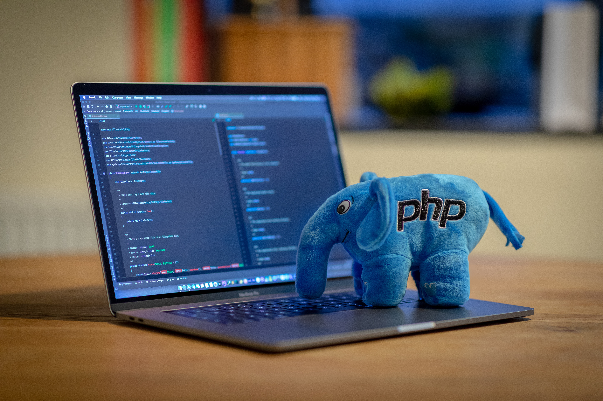

> Il problema non è mai stato `<?php echo $x; ?>`. Il problema è tutto quello che PHP fa *prima* che il tuo codice venga eseguito. In breve:
>
> 🐘 **PHP2Shell** (CVE-2026-109618 e CVE-2026-109619): due RCE **non autenticate** nel cuore di PHP, CVSS 4.0 **9.2**.
>
> 📤 Il punto d'ingresso è una funzione **attiva di default** che lavora anche se l'applicazione non chiama mai `session_start()`: l'**upload progress** delle sessioni.
>
> 🔓 Dettagli trapelati **prima** della patch, sfruttamento osservato già il **17 ottobre**, patch anticipata al **21 ottobre**.
>
> 🔌 Nessun workaround completo: ACN, CERT-EU e NSA hanno consigliato di **mettere offline** i siti non aggiornabili. E molti l'hanno fatto.
>
> 🇮🇹 In Italia **285.149** servizi PHP esposti su versioni vulnerabili (dati CSIRT al 25 ottobre).
>
> 🗜️ Negli stessi giorni è arrivata **HTTP2Shell**, una falla in **Brotli** che colpisce Node.js, Python e tutto ciò che ne include una copia, estensioni PHP comprese.



Nel maggio 2021 ho scritto [PHP nel 2021](/post/2021-05-30-php-nel-2020/), un articolo piuttosto severo: PHP "legacy" senza distinzione tra GET e POST, il routing basato sul file system, il parsing automatico di `multipart/form-data` che apre la porta a upload indesiderati, il deploy scomodo, l'assenza di Unicode nativo. La conclusione era che fare progetti in PHP "liscio" non avesse senso.

Cinque anni dopo, nella settimana tra il 20 e il 25 ottobre 2026, la stessa domanda se la sono posta il ministero dell'Interno, il GARR, Orange e almeno un governo europeo. Non per una questione di stile, ma perché **non avevano altra scelta che spegnere i propri siti PHP** in attesa delle patch.

È giunta l'ora di aggiornare quell'articolo.

## Cosa è successo: PHP2Shell in una settimana

Con il nome **PHP2Shell** (o *php2shell*, con tanto di sito ufficiale: [php2shell.com](https://www.php2shell.com/)) si indica una famiglia di vulnerabilità critiche nel **core** di PHP, non in un framework, non in un CMS, non in un plugin, divulgate congiuntamente da **Wiz**, **OpenAI** e **Calif**[^php2shell]. Le due principali sono:

- **CVE-2026-109618**
- **CVE-2026-109619**

Entrambe permettono a un attaccante **non autenticato** di eseguire codice arbitrario sul server con i privilegi dell'utente del web server, ed entrambe hanno un punteggio CVSS v4.0 di **9.2** (watchTowr arriva a 10.0)[^recordedfuture]. Oltre all'esecuzione di codice, Wiz ha mostrato che la componente di **memory disclosure** può far trapelare password, token di autenticazione, chiavi API e certificati appartenenti **ad altre richieste** servite dallo stesso processo[^wiz]. E il bug è vecchio: sono coinvolte praticamente tutte le versioni dalla **5.4** in poi, cioè oltre un decennio di PHP[^wiz].

La cronologia, ricostruita da più fonti (che non sono sempre d'accordo tra loro), è più o meno questa:

| Data | Evento |
|---|---|
| **11 agosto** | Calif (il ricercatore Ryan Austin, aiutato da un modello OpenAI) e OpenAI segnalano in modo indipendente il bug out-of-memory → RCE, nell'ambito del programma *Patch the Planet*; Wiz registra la propria scoperta il 19 agosto, e più avanti anche Chainguard la trova con un proprio harness basato su IA[^techtarget][^wiz] |
| **17 ottobre** | Amazon registra sui propri honeypot MadPot un primo tentativo di sfruttamento, **quattro giorni prima** della disclosure[^aws] |
| **20 ottobre** | Gli identificativi CVE iniziano a girare sui forum; viene pubblicato per errore un video di PoC; watchTowr conferma in poche ore che le falle sono reali[^techtarget] |
| **21 ottobre** | Cloudflare attiva protezioni WAF circa nove ore prima della pubblicazione[^cloudflare]; Chainguard pubblica alle 07:41 UTC immagini già corrette, di fatto rompendo l'embargo; PHP anticipa il rilascio, previsto per il 22, e pubblica le patch alle 13:35 UTC circa[^techtarget] |
| **21 ottobre** | Iniziano scansioni di massa (VulnCheck osserva lo user-agent `php2shell-scan/109618`)[^vulncheck] |
| **22-24 ottobre** | Amazon parla di sfruttamento ormai diffuso, Sansec è più prudente: gli exploit pubblici non funzionano su un'installazione PHP di default[^php2shell][^sansec] |
| **23 ottobre** | PHP pubblica un avviso informativo per una terza falla, **CVE-2026-115560**, non ancora corretta[^cve115560] |
| **25 ottobre** | Il CSIRT Italia conta ancora **285.149** servizi PHP vulnerabili esposti in Italia[^acn] |

Le versioni corrette sono **8.5.12**, **8.4.27**, **8.3.36** e **8.2.35**[^recordedfuture]. PHP 8.1 e precedenti sono fuori supporto e **non ricevono patch ufficiali**: esistono backport dei sorgenti per 8.1, 8.0 e 7.4, ma vanno compilati a mano. watchTowr ha confermato che sono vulnerabili anche rami antichissimi, **PHP 5 compreso**[^watchtowr].

### Come funzionano (a grandi linee)

Non entro nei dettagli dello sfruttamento: ci sono già PoC pubblici e non serve aggiungerne. Il meccanismo generale però è istruttivo.

Il protagonista è **`session.upload_progress`**, la funzione che permette di seguire l'avanzamento di un upload `multipart/form-data` salvandone lo stato nella sessione. Due dettagli la rendono perfetta per un attacco:

1. è **attiva di default** (`session.upload_progress.enabled = On`);
2. lavora **durante il parsing della richiesta**, prima che il tuo script venga eseguito, e **anche se l'applicazione non chiama mai `session_start()`**[^sansec].

Le due falle, secondo le analisi pubblicate:

- **una use-after-free**: il gestore degli upload (RFC 1867) tiene in cache dei puntatori a una struttura della sessione; con un upload rallentato ad arte tra un blocco e l'altro la sessione viene reinizializzata, la struttura liberata, ma i puntatori restano lì a puntare a memoria che nel frattempo può contenere dati scelti dall'attaccante[^lab];
- **una corruzione di memoria da out-of-memory**: se la richiesta supera il `memory_limit` nel momento sbagliato, PHP si interrompe con delle strutture interne inizializzate a metà, e la pulizia di fine richiesta le tratta come valide[^tenable].

C'è persino disaccordo su quale CVE corrisponda a quale bug: Akamai e la maggior parte delle fonti associano la use-after-free dell'upload progress a CVE-2026-109619, Sansec invece fa l'associazione opposta[^sansec]. Per chi deve aggiornare cambia poco: **servono entrambe le patch**.

Va detto che lo sfruttamento reale dipende molto dalla configurazione: Sansec ritiene uno sfruttamento di massa meno probabile di quanto temuto il giorno del rilascio, perché gli exploit pubblici non funzionano contro un PHP installato con le impostazioni di default[^sansec]. Ma "meno probabile" non è "impossibile", e nessuno sa con certezza quale combinazione di `php.ini`, SAPI e applicazione abbia il proprio server.

I deployment considerati più a rischio sono quelli con **Apache + mod_php**, ma sono coinvolti anche **PHP-FPM**, **php-cgi**, **FrankenPHP** e **LiteSpeed**[^recordedfuture].

### Il dettaglio che nel 2021 avevo già intravisto

Rileggendo il vecchio articolo, una frase mi ha fatto sorridere amaramente:

> PHP effettua un parsing automatico dell'input in base se è `application/x-www-form-urlencoded` o `multipart/form-data`

All'epoca la criticavo per ragioni di design: niente JSON nativo in `$_POST`, upload salvati in una cartella temporanea senza che lo script li abbia chiesti. Nel 2026 lo stesso principio è diventato una RCE: **PHP fa un sacco di lavoro sull'input dell'utente prima che il programmatore abbia scritto una sola riga**, e quel lavoro è codice C che gira su ogni richiesta di ogni sito.

La superficie d'attacco di un sito PHP non è il tuo `index.php`. È `index.php` **più** tutto il runtime che lo precede: parsing delle richieste, upload, sessioni, `php.ini` con decenni di default "comodi".

È la stessa lezione che avevo raccontato per [Next.js](/post/2025-12-07-nextjs-vulnerabilita-startup-devops-dockerfile/): la magia che lavora per te lavora anche per l'attaccante.

## Perché mezzo mondo ha spento PHP

Una RCE critica in un software diffuso non è una novità. Quello che ha reso PHP2Shell diverso sono tre fattori combinati.

**1. Nessun workaround completo.** Il primo consiglio circolato è stato disattivare l'upload progress:

```ini
session.upload_progress.enabled = 0
```

Ma copre in modo affidabile solo una delle due falle. Su PHP 8.5 serve anche `fatal_error_backtraces = 0`, e per la parte out-of-memory i vendor hanno proposto mitigazioni poco eleganti, come spostare i limiti di memoria sul frontend e sul container[^datadog]. Il team di PHP è stato chiaro: **non ci sono mitigazioni complete, l'unica scelta sicura è aggiornare**[^recordedfuture].

**2. Metà del parco installato non riceverà mai una patch.** Secondo Talos circa **la metà** dei sistemi PHP gira su versioni che non riceveranno una correzione ufficiale[^socket]. W3Techs dice che PHP 8 è usato dal **62,5%** dei siti PHP[^w3techs8]: il resto è su PHP 7 o, peggio, su PHP 5. E anche dentro PHP 8 ci sono le 8.0 e 8.1, già fuori supporto.

**3. La scala.** PHP è ancora il linguaggio lato server di circa il **70,5%** dei siti di cui si conosce la tecnologia[^w3techs]. Palo Alto stima oltre **22,6 milioni** di istanze esposte potenzialmente vulnerabili[^unit42].

Il risultato è che, per la prima volta da molto tempo, le autorità hanno consigliato apertamente di **spegnere** i servizi:

- la **NSA** ha raccomandato di mettere offline i sistemi coinvolti fino alla completa mitigazione, il **CERT-EU** di isolare le applicazioni non aggiornate dalle reti pubbliche[^socket];
- **Orange** ha sospeso in via precauzionale l'accesso a diversi siti e app[^techradar];
- almeno **un governo europeo** ha messo offline il proprio sito[^unit42];
- in Italia l'**ACN** ha raccomandato di *"valutare di porre offline i siti e i servizi web che utilizzano versioni vulnerabili di PHP, sospendendone l'accessibilità fino all'avvenuto aggiornamento"*[^acn]; il **GARR** ha isolato alcune piattaforme il 21 ottobre[^smartworld] e il **ministero dell'Interno** ha oscurato i siti delle prefetture in attesa delle patch[^smartworld].

I numeri italiani del CSIRT sono impietosi: su **741.523** servizi PHP rilevati, **285.149** usano versioni potenzialmente vulnerabili, cioè l'**81,9%** di quelli di cui è stato possibile identificare la versione[^acn].

Chi stava su hosting gestito, in gran parte, non si è accorto di nulla: provider come SiteGround hanno applicato regole di mitigazione a livello di server prima della pubblicazione e poi installato le patch ufficiali[^siteground]. Cloudflare ha distribuito regole WAF dedicate[^cloudflare]. Chi invece aveva il classico VPS "installato una volta nel 2019 e mai più toccato" si è trovato a dover scegliere tra spegnere o rischiare. Oppure, ed è la scelta più diffusa, non ha scelto affatto: ha semplicemente **ignorato** il problema, perché non sa nemmeno più cosa gira su quella VPS, quale versione di PHP ci sia sopra o se qualcuno se ne ricordi la password di root.

### Il seguito: CVE-2026-115560

Il 23 ottobre, due giorni dopo le patch, PHP ha pubblicato un avviso informativo per una **terza** falla nello stesso sottosistema, la **CVE-2026-115560**. Colpisce anche le versioni appena corrette, ma solo con una configurazione molto particolare: serializzatore delle sessioni impostato a `php_binary` o `php_serialize` nel `php.ini` e poi cambiato a runtime con `ini_set()`, con l'upload progress attivo[^cve115560].

PHP la considera un rischio improbabile e la correggerà nel prossimo rilascio ordinario. Nel frattempo la raccomandazione è sempre la stessa: `session.upload_progress.enabled = 0`. Chi l'aveva già fatto per PHP2Shell non deve fare altro.

La morale però è chiara: **quando si apre un sottosistema, i ricercatori (e gli attaccanti) ci scavano dentro per settimane**. Aspettatevi altre CVE sull'upload progress.

## E poi è arrivata HTTP2Shell

Come se non bastasse, negli stessi giorni è esplosa **HTTP2Shell**, cioè la **CVE-2026-111497**: una scrittura fuori dai limiti nel decoder **Brotli** di Google (versioni dalla 1.0.3 alla 1.2.0), l'algoritmo di compressione usato tra l'altro per il `Content-Encoding: br` di HTTP. Uno stream compresso costruito ad arte corrompe la memoria di qualsiasi processo che lo decomprime, e anche questa ha un punteggio CVSS 4.0 di **9.2**[^http2shell].

La stessa falla ha cambiato nome tre volte in pochi giorni:

- **Node2Shell**, perché Node.js è stato il primo a correggerla (22.23.4, 24.22.1, 26.12.1);
- **Python2Shell**, quando si è capito che colpiva anche i pacchetti `brotli` e `brotlicffi`;
- **HTTP2Shell**, dal 23 ottobre, quando è emerso che qualsiasi stack che include una copia del decoder è esposto: .NET, Ruby, DuckDB, ClickHouse, 7-Zip e, appunto, anche PHP[^http2shell].

Nonostante il nome, **non è una falla del protocollo HTTP/2**: il problema è nella decompressione. Per PHP il core non è coinvolto, ma le estensioni e le librerie che includono una propria copia di Brotli sì[^http2shell]. Chi le usa deve verificare che siano state ricompilate con Brotli 1.0.10, 1.1.1 o 1.2.1, e ricordarsi che un client HTTP che accetta `br` decomprime dati scelti dal server remoto.

E c'è un vettore ancora meno ovvio: le **immagini JPEG XL**. Il formato usa Brotli per comprimere i metadati (i box `brob`, che contengono per esempio Exif e XMP), e **libjxl** li decomprime con il decoder vulnerabile semplicemente aprendo il file[^jxl]. Per un sito PHP significa che non serve nemmeno la compressione HTTP: basta un'immagine `.jxl` caricata da un utente e passata a **Imagick**/ImageMagick o a **libvips** compilati con il supporto JPEG XL per creare la miniatura. Al momento in cui scrivo la correzione è nel ramo principale di libjxl ma non ancora in una release, e diversi progetti (come SDL_image) stanno aggiornando la propria copia inclusa[^jxl]. Finché le librerie di sistema non sono aggiornate, conviene rifiutare gli upload JPEG XL o almeno non elaborarli lato server.

Non è un caso che proprio JPEG XL abbia una storia travagliata nei browser. Chrome aveva tolto il supporto sperimentale nella versione 110 (inizio 2023): le motivazioni ufficiali parlavano di scarso interesse dell'ecosistema, ma sullo sfondo c'era il timore della superficie d'attacco di un decoder C++ complesso come libjxl, timore condiviso apertamente da Mozilla. Il formato è tornato in Chromium solo con **jxl-rs**, un decoder scritto da zero in **Rust**, quindi *memory safe*, e Google ha annunciato il supporto ufficiale a partire da Chrome 155[^chromejxl]. Con il senno di poi, HTTP2Shell dà ragione a quella prudenza.

La lezione è più generale: **gli stack di compressione e di decodifica delle immagini sono i peggiori**. Sono parser scritti in C o C++, ottimizzati all'osso per le prestazioni, che per definizione elaborano dati arrivati dall'esterno. La storia è lunga: ImageTragick in ImageMagick nel 2016 (CVE-2016-3714), la falla di libwebp sfruttata nel 2023 da spyware commerciali (CVE-2023-4863), le periodiche vulnerabilità in zlib, 7-Zip e compagnia. Ogni sito PHP che crea una miniatura da un'immagine caricata da un utente o decomprime un archivio sta eseguendo uno di questi parser su input non fidato.

Il fenomeno è interessante quanto la falla: in una settimana di panico **i nomi commerciali delle vulnerabilità si moltiplicano e si mescolano**, PHP2Shell, Node2Shell, Python2Shell, HTTP2Shell, e ogni nuovo nome genera un nuovo giro di allarmi. Il nome che conta è sempre e solo il **CVE**.

## Il resto del 2026 nel mondo PHP

PHP2Shell ha oscurato tutto il resto, ma il 2026 dell'ecosistema PHP era già stato movimentato, soprattutto sul fronte **supply chain**:

- ad **aprile** sono state corrette due command injection nel driver Perforce di **Composer** (CVE-2026-40176 e CVE-2026-40261): la seconda poteva essere attivata da una **dipendenza avvelenata**, perché qualsiasi pacchetto può dichiarare Perforce come sorgente[^composer];
- tra **aprile e maggio** il pacchetto `intercom/intercom-php` è stato compromesso due volte, la seconda nell'ambito della campagna *Mini Shai-Hulud* nata nel mondo npm[^composer];
- a **maggio** su Packagist sono finite versioni malevole dei pacchetti **Laravel-Lang**, con uno script post-install che scaricava un credential stealer[^composer].

Il mondo PHP, che per anni si è sentito al riparo dagli incidenti di npm "perché da noi le dipendenze sono poche", ha scoperto di non esserlo affatto.

## Cosa avevo sbagliato nel 2021 (e cosa no)

Per onestà intellettuale, rileggiamo il vecchio articolo con gli occhi del 2026.

**Cosa avevo sbagliato:**

- **Le prestazioni come scusa per non aggiornare**: nel 2021 la 7 aveva deluso molti, me compreso, e tanti erano rimasti sulla 5. Con la serie 8 la scusa non regge più: con OPcache ormai maturo e il compilatore JIT è la serie 8 a essere più veloce, e restare su una versione vecchia non ha più alcuna giustificazione prestazionale.
- **"Linguaggio morto"**: decisamente no. PHP è ancora intorno al **70%** dei siti con tecnologia lato server nota[^w3techs] e il linguaggio è migliorato tantissimo: PHP 8.5, uscito il 20 novembre 2025, ha portato il **pipe operator** `|>`, un'estensione **URI** conforme a RFC 3986 e WHATWG, `clone with`, l'attributo `#[\NoDiscard]`, `array_first()` e `array_last()`[^php85]. Tipi, enum, readonly, attributi: scrivere PHP moderno è un'altra esperienza rispetto al 2015.
- **Il deploy**: oggi tra container, FrankenPHP e piattaforme gestite il deploy di un'applicazione PHP non è più complicato di quello di un'app Node o Python. Eppure tantissimi continuano a usare la VPS configurata a mano, con Apache, mod_php e i file caricati via FTP o `git pull`: esattamente le installazioni che PHP2Shell ha colpito di più.

**Cosa avevo visto giusto:**

- **Il PHP "liscio", senza framework, è il problema.** Le installazioni più colpite da PHP2Shell non sono le applicazioni Laravel o Symfony mantenute con una pipeline CI/CD, ma la coda lunghissima di siti caricati via FTP su un server condiviso, con un `php.ini` di default e una versione di PHP che nessuno ricorda più.
- **Il runtime fa troppe cose da solo.** Parsing automatico dell'input, upload temporanei, sessioni: comodità del 1998 che nel 2026 sono superficie d'attacco attiva di default.
- **Il routing sul file system** e i file "dimenticati" nella document root restano un problema: un sito mai aggiornato espone tutto ciò che c'è nella cartella.

La conclusione del 2021 quindi non solo regge, ma va rafforzata: **fare progetti in PHP "liscio", senza framework e senza una pipeline di aggiornamento, non aveva senso allora e nel 2026 è diventato pericoloso.** La sintassi è migliorata, ma il runtime si porta ancora dietro le scelte degli anni '90, e PHP2Shell ce l'ha ricordato nel modo più brutale.

## Cosa fare adesso

Se gestite anche un solo sito PHP:

1. **Controllate la versione di PHP del server**, non solo quella di WordPress, del tema o dei plugin. Aggiornare WordPress **non** corregge PHP2Shell[^macitynet].
2. **Aggiornate** a 8.5.12, 8.4.27, 8.3.36 o 8.2.35 o successive. Su Debian, Ubuntu, RHEL e derivate controllate il bollettino della distribuzione: le versioni pacchettizzate hanno numerazioni diverse ma contengono i backport.
3. Se siete su **PHP 8.1 o precedenti**, il momento di migrare a una versione supportata era ieri. Se proprio non potete, ricompilate con i backport o spegnete il servizio.
4. Nel frattempo disattivate l'upload progress (`session.upload_progress.enabled = 0`) in `php.ini`, `.user.ini` o `.htaccess`: non basta, ma riduce il rischio e copre anche la CVE-2026-115560.
5. Se usate i **container**, **ricostruite le immagini**: aggiornare l'host non aggiorna il PHP dentro l'immagine. E smettete di usare tag non fissati.
6. **Controllate i log** dal 17 ottobre in poi: richieste `multipart/form-data` anomale e lente, processi figli sospetti del web server, file PHP nuovi nella document root.
7. Se fate software per conto terzi, ricordate che dall'**11 settembre 2026** il [Cyber Resilience Act](/post/2026-10-11-cyber-resilience-act-responsabilita-software-open-source/) impone ai produttori di segnalare le vulnerabilità attivamente sfruttate nei propri prodotti. Un CMS venduto con un PHP vulnerabile dentro l'immagine è esattamente il caso di cui parla.

## L'elefante nella stanza: l'IA

Un'ultima osservazione. Il sito ufficiale si intitola, non a caso, *"AI uncovers critical vulnerabilities in the backbone of the web"*[^php2shell]. Secondo le ricostruzioni, PHP2Shell è stata trovata **indipendentemente da almeno quattro gruppi in poche settimane**, e quasi tutti hanno usato modelli di IA per farlo[^techtarget]. Un bug rimasto nel codice C di PHP per anni è emerso da più parti contemporaneamente.

Questo cambia le regole: se un bug può essere trovato in modo semiautomatico da chiunque disponga di un buon modello, **l'embargo non regge più**, la finestra tra scoperta e sfruttamento si riduce a giorni (qui lo sfruttamento è iniziato *prima* della patch) e le installazioni non aggiornabili diventano un rischio immediato, non teorico.

## Il vero problema: aggiornare in tempo, senza rompere tutto

Come ho scritto [su LinkedIn](https://www.linkedin.com/feed/update/urn:li:activity:7520073426368294912/), il vero problema oggi non è solo scoprire le vulnerabilità, ma **riuscire a correggerle in tempo** e, al contempo, **validare ogni singolo aggiornamento**.

PHP2Shell lo dimostra bene: le patch sono uscite il 21 ottobre, ma quattro giorni dopo in Italia l'81,9% dei servizi PHP di cui si conosce la versione era ancora vulnerabile. Non perché gli amministratori non sapessero della falla, ma perché aggiornare un sistema in produzione fa paura, e spesso a ragione. Il caso di una famosa banca italiana che nel 2024 ha subito giorni di disservizi in seguito a un aggiornamento tecnologico ci ricorda quanto sia delicato intervenire su sistemi IT critici.

Con l'IA che accelera sia l'individuazione sia lo sfruttamento delle vulnerabilità, però, non possiamo più permetterci che l'aggiornamento di una dipendenza vulnerabile, o del runtime stesso, richieda giorni di verifiche manuali.

La risposta è **automatizzare completamente la validazione delle release**:

- pipeline **CI/CD** che ricostruiscono e ridistribuiscono l'applicazione a ogni aggiornamento;
- **test automatici** di regressione e di integrazione;
- **controlli di sicurezza** e **verifica delle dipendenze** (SBOM, scanner, lockfile);
- **rollback automatici** quando qualcosa va storto.

L'obiettivo non è eliminare il controllo umano, ma **evitare che diventi un collo di bottiglia**: i test devono essere automatizzati e affidabili al punto da consentire aggiornamenti frequenti, rapidi e sicuri, riservando l'intervento umano alle eccezioni e alle decisioni critiche.

Perché oggi il rischio è duplice:

- **aggiornare troppo lentamente** significa lasciare aperta una vulnerabilità, e con PHP2Shell la scelta è stata spegnere il sito;
- **aggiornare senza validare** significa rischiare di compromettere la continuità del servizio.

La sfida è trovare il giusto equilibrio attraverso l'automazione: **automatizzare i test per poter aggiornare in sicurezza, alla velocità richiesta dalle nuove minacce.** Chi aveva una pipeline del genere il 21 ottobre ha cambiato una riga nel Dockerfile, ha lasciato girare i test ed è andato a pranzo. Chi non l'aveva ha spento il sito.

Per PHP, che si porta dietro trent'anni di codice C e milioni di installazioni dimenticate, PHP2Shell non sarà l'ultima. Ma se la prossima volta ci troverà con versioni supportate, pipeline di aggiornamento e default più prudenti, forse non sarà necessario spegnere mezzo internet per qualche giorno.

---

[^php2shell]: Sito ufficiale della disclosure, [PHP2Shell — AI uncovers critical vulnerabilities in the backbone of the web](https://www.php2shell.com/).

[^wiz]: Wiz, [PHP2Shell: AI uncovers critical RCE vulnerabilities affecting 70% of the Internet](https://www.wiz.io/blog/php2shell-php-rce); The Hacker News, [PHP2Shell: Two Unpatched Critical PHP RCE Flaws](https://thehackernews.com/2026/10/php2shell-two-unpatched-critical-php.html); Imperva, [PHP2Shell: When PHP Runs Out of Memory at the Wrong Moment](https://www.imperva.com/blog/php2shell-vulnerability-updates/).

[^recordedfuture]: Recorded Future, [PHP2Shell Exploitation: Two Critical PHP Flaws Explained](https://www.recordedfuture.com/blog/php2shell-vulnerability-exploitation); Akamai, [Understanding PHP2Shell](https://www.akamai.com/blog/security-research/understanding-php2shell-everything-you-need-to-know).

[^techtarget]: TechTarget, [PHP2Shell disclosure unravels after leaks forced early patch drop](https://www.techtarget.com/cybersecurity/news/366652613/PHP2Shell-disclosure-unravels-after-leaks-forced-early-patch-drop); Infosecurity Magazine, [Critical PHP Vulnerabilities Leaked Ahead of Scheduled Security Patch](https://www.infosecurity-magazine.com/news/critical-php-vulnerabilities-leaked/). Le attribuzioni della scoperta differiscono tra le fonti.

[^aws]: Amazon, [Amazon Threat Intelligence identifies PHP2Shell exploitation prior to public disclosure in MadPot](https://aws.amazon.com/blogs/security/amazon-threat-intelligence-identifies-php2shell-exploitation-prior-to-public-disclosure-in-madpot/).

[^vulncheck]: VulnCheck, [PHP2Shell Vulnerabilities: CVE-2026-109618 and CVE-2026-109619](https://www.vulncheck.com/blog/php2shell-vulnerabilities).

[^watchtowr]: watchTowr, [PHP2Shell FAQ](https://watchtowr.com/intelligence/php-cve-2026-109618-faq/) e [PHP2Shell RCE Exploited](https://watchtowr.com/intelligence/php-remote-code-execution-php2shell/).

[^sansec]: Sansec, [PHP2Shell: PHP RCE](https://sansec.io/research/php2shell).

[^lab]: Analisi tecniche: [php2shell: Dissecting PHP's Critical Session Upload Progress Vulnerabilities](https://qideng.substack.com/p/php2shell-dissecting-phps-critical); Datadog Security Labs, [PHP2Shell - Critical vulnerabilities in PHP](https://securitylabs.datadoghq.com/articles/php2shell-critical-vulnerabilities-in-php/).

[^tenable]: Tenable, [php2shell: Frequently Asked Questions](https://www.tenable.com/blog/php2shell-cve-2026-109618-cve-2026-109619-frequently-asked-questions-about-critical-php-remote); JFrog, [PHP2Shell: All You Need to Know](https://research.jfrog.com/post/php2shell-all-you-need-to-know-about-cve-2026-109618-and-cve-2026-109619/).

[^datadog]: Datadog Security Labs, [PHP2Shell: detection, analysis, and remediation](https://securitylabs.datadoghq.com/articles/php2shell-critical-vulnerabilities-in-php/).

[^socket]: Socket, [PHP Patches Critical RCE Vulnerabilities, Organizations Urged to Take Unpatched Sites Offline](https://socket.dev/blog/php-critical-rce-patches); Cisco Talos, [Two critical RCEs in PHP core](https://blog.talosintelligence.com/two-critical-rces-in-php-core/).

[^w3techs]: W3Techs, [Usage statistics of PHP](https://w3techs.com/technologies/details/pl-php), agosto 2026.

[^w3techs8]: W3Techs, [Usage statistics of PHP version 8](https://w3techs.com/technologies/details/pl-php/8), agosto 2026.

[^unit42]: Palo Alto Networks Unit 42, [Threat Brief: Critical Vulnerabilities in PHP](https://unit42.paloaltonetworks.com/cve-2026-109618-cve-2026-109619/).

[^techradar]: TechRadar, [PHP security crisis — what you need to know](https://www.techradar.com/pro/live/php-issues-affect-websites-across-the-world-all-the-latest-updates-and-what-you-need-to-know).

[^acn]: ACN, [PHP2Shell: sanate vulnerabilità critiche in PHP](https://www.acn.gov.it/portale/en/w/php2shell-sanate-vulnerabilita-critiche-in-php); CyberSecItalia, [PHP2Shell, alert di ACN](https://www.cybersecitalia.it/lalert-dellacn-in-italia-a-rischio-vulnerabilita-oltre-250mila-servizi-php-fare-subito-laggiornamento-php-e-uno-dei-linguaggi-per-far-funzionare-gran-pa/70850/).

[^smartworld]: SmartWorld, [Cos'è la falla PHP2Shell e perché tanti siti sono stati oscurati](https://www.smartworld.it/news/php2shell-falla-php-siti-oscurati.html); PhoneToday, [PHP2Shell, due falle critiche in PHP: siti pubblici oscurati anche in Italia](https://www.phonetoday.it/php2shell-falle-php-siti-oscurati/).

[^siteground]: SiteGround, [Critical PHP vulnerabilities: SiteGround sites protected](https://www.siteground.com/blog/critical-php-vulnerabilities-october-2026).

[^cloudflare]: Cloudflare, [Cloudflare deploys protections against php2shell vulnerability](https://blog.cloudflare.com/php-vulnerabilities-waf-protection/).

[^cve115560]: The Hacker News, [PHP Warns of Another Unpatched RCE Risk Two Days After Emergency PHP2Shell Patches](https://thehackernews.com/2026/10/urgent-php-warns-of-another-unpatched.html); Red Hat, [RHSB-2026-013](https://access.redhat.com/security/vulnerabilities/RHSB-2026-013).

[^http2shell]: Strobes, [HTTP2Shell: Brotli RCE in Node.js and Python](https://strobes.co/blog/http2shell-brotli-rce-cve-2026-111497/); Brandefense, [HTTP2Shell: One Brotli Flaw, Many Stacks and Their Fixes](https://brandefense.io/blog/http2shell-brotli-cve-2026-111497/); Imperva, [Node2Shell: From Brotli Data to Remote Code Execution](https://www.imperva.com/blog/node2shell-from-brotli-data-to-remote-code-execution/).

[^jxl]: Phoenix Security, [HTTP2Shell Expansion (CVE-2026-111497): Where the Brotli Decoder Bug Went After Node.js and Python](https://phoenix.security/http2shell-expansion-cve-2026-111497-brotli-bundled-copies); SDL, [SDL_image: bump vendored libjxl for brotli/CVE-2026-111497](https://discourse.libsdl.org/t/sdl-image-bump-vendored-libjxl-for-brotli-cve-2026-111497/69637); Debian, [CVE-2026-111497 Security Tracker](https://security-tracker.debian.org/tracker/CVE-2026-111497).

[^chromejxl]: Phoronix, [JPEG-XL Image Support Returns To Latest Chrome / Chromium Code](https://www.phoronix.com/news/JPEG-XL-Returns-Chrome-Chromium); TechRadar, [Google quietly brings JPEG XL back to Chrome](https://www.techradar.com/pro/google-restores-much-missed-jpeg-xl-format-to-chromium-code-base-better-image-compression-and-better-bandwidth-are-on-the-way); [Chrome 155 to Support JPEG XL, Using a Rust Decoder](https://xenospectrum.com/en/chrome-155-jpeg-xl-rust/).

[^composer]: The Hacker News, [articoli su Composer](https://thehackernews.com/search/label/Composer); GitLab Advisory Database, [intercom/intercom-php](https://advisories.gitlab.com/pkg/composer/intercom/intercom-php/).

[^php85]: PHP, [PHP 8.5 Released](https://www.php.net/releases/8.5/index.php).

[^macitynet]: Macitynet, [PHP2Shell, siti offline anche in Italia: cosa deve fare chi usa WordPress](https://www.macitynet.it/php2shell-vulnerabilita-php-siti-offline/).
