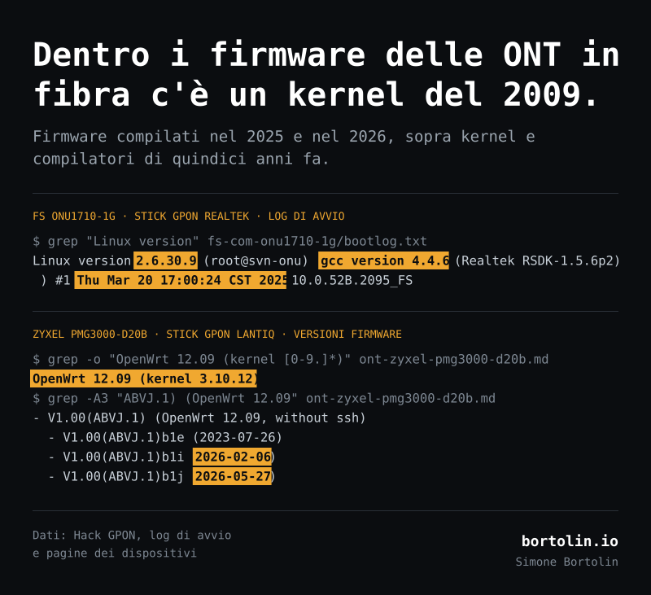
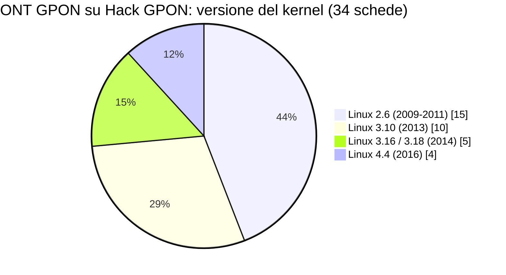
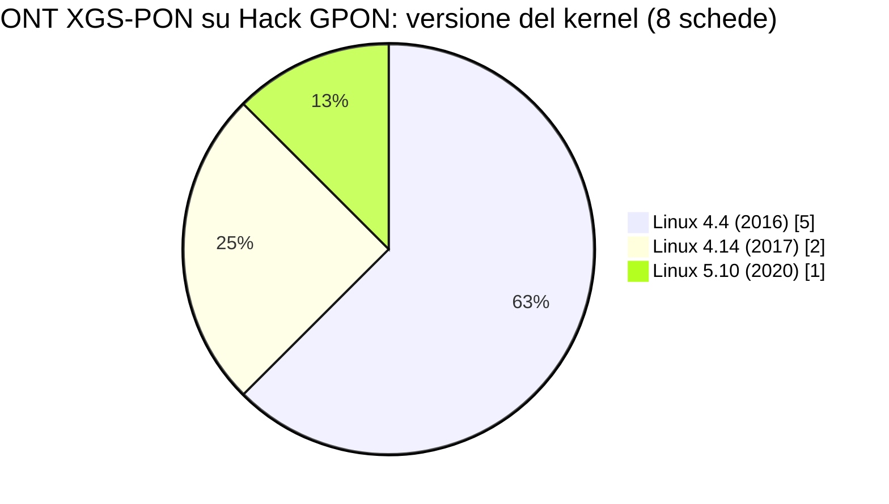
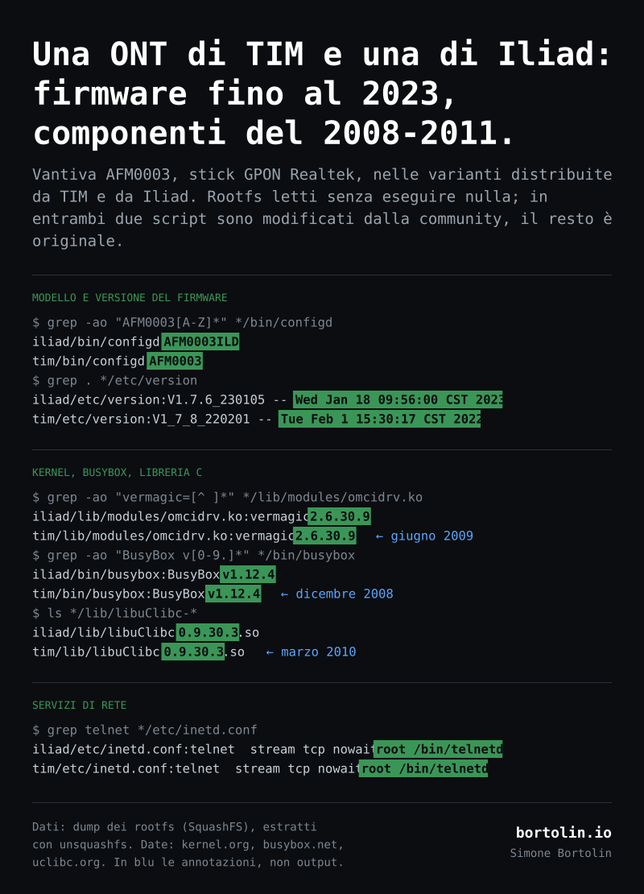
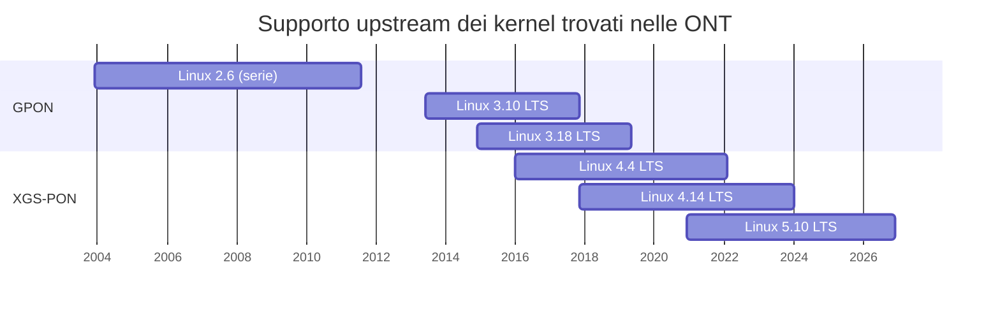
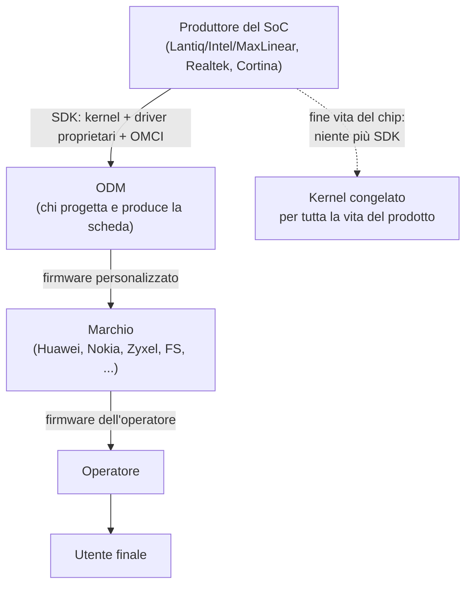

> La rete in fibra va a 10 Gbit/s. Il software che la termina gira su Linux 2.6. In breve:
>
> 🔦 Da GPON a XGS-PON la banda è quadruplicata, **il software delle ONT no**.
>
> 🧬 Nei firmware documentati su Hack GPON: **Linux 2.6** (Realtek), **3.10** (Lantiq), **4.4–5.10** (XGS-PON).
>
> 🐛 Secondo i dati del kernel stesso, un 3.10 ha **quasi 2.900 CVE mai corrette**, e aggiornarlo all'ultima 3.10 non ne toglie nessuna.
>
> 🧱 Il collo di bottiglia sono gli **SDK proprietari**: driver legati a un kernel e mai portati avanti.
>
> 🔑 Credenziali fisse, segreti derivati dal MAC, cifrari del 2000: **la sicurezza segue il kernel**.
>
> 🛠️ **Peter Pon** porta una ONT Lantiq del 2014 su OpenWrt moderno e Linux 6.18, **senza cambiare hardware**.
>
> 🇪🇺 Con il **CRA**, «funziona, non toccare» smette di essere una politica di aggiornamento accettabile.

Negli ultimi anni la fibra in Italia ha fatto passi enormi. Il GPON, con i suoi 2,5 Gbit/s in download e 1,25 in upload condivisi tra gli utenti di un albero ottico, sta lasciando spazio all'XGS-PON, simmetrico a 10 Gbit/s. Gli operatori vendono profili da 2,5, 5 e 10 Gbit/s, le OLT vengono sostituite, i router hanno porte SFP+.

Poi apri il terminale ottico, l'ONT, e trovi un kernel Linux che non riceve patch da prima della pandemia. In alcuni casi da prima che esistesse l'iPhone 4.

Ne ho parlato a lungo nell'articolo su [modem, router e ONT liberi](/post/2023-11-16-modem-router-e-ont-liberi/): l'ONT è l'apparato che parla con la OLT dell'operatore. In teoria è l'ultimo pezzo della rete dell'ISP, un convertitore ottico e poco più. Ma sta dentro casa dell'utente, e sostituirlo non è un diritto ed è difficile da ottenere. Ed è proprio per questo che vale la pena guardarci dentro.

Io l'ho fatto. Il risultato è che **ho tolto le ONT con firmware originale** dalla mia rete di casa e da quella dei miei genitori. Non per passione del modding: ci avevo provato tempo fa, e poi ne avevo perso il gusto. L'ho fatto perché quello che ci girava sotto non mi dava nessuna fiducia. Tecnicamente quelle ONT non erano nemmeno raggiungibili dalla mia LAN, invisibili a livello 2. Ma se una vulnerabilità colpisse il router, la ONT subito dietro diventerebbe il passo successivo di un attacco. Per lavoro adeguo software ai requisiti europei di cybersicurezza: sapere di avere in casa un kernel di quindici anni fa, e un'interfaccia web che è un vero obbrobrio, mi dava parecchio fastidio. Non si sa mai.

## L'ONT è un computer Linux che nessuno guarda

Una ONT, che sia un box da muro o uno stick SFP, non è un semplice convertitore ottico-elettrico. È un sistema completo:

- un **SoC** con una CPU (MIPS, nella maggior parte dei casi), qualche decina di MB di RAM e una flash da 16 o 128 MB;
- un **motore di pacchetti** hardware che fa il lavoro vero sul traffico;
- un **kernel Linux** con i driver del MAC e OMCI/GPON, dell'ottica e dello switch;
- un demone **OMCI**, il protocollo con cui la OLT configura la ONT;
- un **userspace** con BusyBox, un server web, SSH o Telnet, qualche script di configurazione.

Sul Huawei MA5671A, lo stick da modding che non tramonta mai, anche se con il firmware di serie non è il più adatto ai profili da 2,5 Gbit/s, il SoC è un Lantiq FALC ON con un core MIPS 34Kc, 64 MB di RAM e 16 MB di flash[^peterpon_c1]. Un computer vero, insomma, con un IP di gestione raggiungibile dalla rete locale.

E come ogni computer, il suo livello di sicurezza dipende dal software che ci gira. Che è il punto dolente.

## Cosa c'è davvero dentro: i kernel nei binari

Le schede tecniche dei produttori, quando dicono qualcosa sul software, parlano di "Linux" e basta. Per sapere cosa gira davvero bisogna aprire i firmware.

È quello che si fa su Hack GPON[^hg_repo], il wiki sulle ONT di cui seguo, nel tempo libero, le attività di "product care": le versioni dei kernel vengono estratte **direttamente dai binari** dei firmware, non dalle schede commerciali. Raggruppate per piattaforma:

| Piattaforma | SoC | SDK | Kernel rilevato nei binari |
|---|---|---|---|
| GPON Lantiq | FALC ON (PEB98035) | Lantiq/Intel FALC ON | **Linux 3.10**, pesantemente patchato |
| GPON Realtek | RTL9601B/C/CI/D | Luna SDK 1.9 | **Linux 2.6** |
| GPON Realtek | RTL9601CI/D | Luna SDK 3.3 | **Linux 3.18**, il massimo possibile con l'SDK |
| XGS-PON | CA8271x, RTL9615C | Saturn SDK, SDK Realtek | **Linux 4.4, 4.14, 5.10** |

Qualche esempio:

- la **FS GPON-ONU-34-20BI** (FALC ON) dichiara «OpenWRT 14.07_ltq (Kernel 3.10.49)», con U-Boot 2011.12[^hg_fs];
- la **Zyxel PMG3000-D20B** (FALC ON) ha avuto due linee di firmware: OpenWrt 12.09 con kernel 3.10.12 e OpenWrt 14.07 con kernel 3.10.49, BusyBox 1.19.4 e 1.22.1[^hg_zyxel];
- le ONT Realtek come la **ODI DFP-34X-2C2** e la **ZTE F6005** riportano «Luna SDK 1.9»[^hg_odi][^hg_zte]; la più recente **LEOX LXT-010S-H** è su «Linux 3.18 (Luna SDK 3.3)»[^hg_leox];
- sul lato XGS-PON, la **Nokia XS-010X-Q** e la **FS XGS-ONU-25-20NI** usano un «Custom Linux by Cortina (Saturn SDK) based on Kernel 4.4»[^hg_nokia_xgs][^hg_fs_xgs], la **KAON PM1191** è su Linux 4.14.275[^hg_kaon], mentre la **Comtrend GRG-4362**, con SoC Realtek RTL9615C, arriva a Linux 5.10.70[^hg_grg4362].

Il Saturn SDK nasce in Cortina Access, la società che sviluppa la famiglia CA8271x e che è poi stata acquisita da Realtek. Il che porta a un'osservazione curiosa: **dentro lo stesso ecosistema Realtek convivono generazioni di kernel lontane più di dieci anni**. Le ONT GPON con Luna SDK 1.9 sono ferme al 2.6, quelle con Luna SDK 3.3 al 3.18, le XGS-PON spaziano dal 4.4 al 5.10.

### Il censimento di Hack GPON

Per avere il quadro completo ho analizzato tutto il repository di Hack GPON, che documenta oltre cento ONT, ed estratto le versioni del kernel dalle tabelle hardware e dai log di avvio di ogni pagina (dati al 16 novembre 2026).

Il risultato, per prima cosa, è che **la maggior parte delle pagine non dice che kernel c'è dentro**: delle 82 schede di ONT GPON, solo 19 riportano una versione esplicita. Per altre 15 la versione si ricava con buona sicurezza:

- le 9 schede Realtek che indicano «Luna SDK 1.9» senza versione del kernel: tutte le ONT con Luna SDK 1.9 di cui conosciamo il kernel, compresa la Nokia G-010G-R con il suo log di avvio, girano su **Linux 2.6.30.9**;
- le 6 schede Lantiq FALC ON che indicano solo «OpenWRT»: tutti i firmware FALC ON con una versione nota sono su **Linux 3.10**.

Su queste 34 ONT GPON il quadro è questo:

**Il 44% delle ONT GPON è ancora su Linux 2.6**, quasi tre quarti su un kernel uscito prima del 2014, e nessuna su un kernel più recente del 4.4, fuori supporto upstream dal 2022. Fuori dal conteggio restano due stick che non usano Linux ma eCos, un sistema operativo embedded.

Sulle XGS-PON le pagine sono ancora più avare: delle 24 schede, solo 8 riportano il kernel.

La tecnologia più nuova, quella da 10 Gbit/s, gira per lo più su un kernel del 2016.

### Kernel vecchi, firmware nuovi

C'è un dato che i grafici non mostrano: **quando sono stati compilati quei firmware**. Un kernel 2.6 in un firmware del 2010 è una cosa, in un firmware dell'anno scorso è un'altra. Hack GPON lo riporta solo per pochi modelli, ma quei pochi bastano:

- sulla **FS ONU1710-1G** il log di avvio mostra un **Linux 2.6.30.9 compilato il 20 marzo 2025**, con gcc 4.4.6, un compilatore del 2011[^hg_onu1710];
- la **Zyxel PMG3000-D20B** ha ricevuto build della linea V1.00(ABVJ.1), quella su **OpenWrt 12.09 e kernel 3.10.12**, a luglio 2023, **febbraio 2026 e maggio 2026**[^hg_zyxel];
- la **LEOX LXT-010S-H**, con Luna SDK 3.3 e kernel 3.18, ha firmware compilati tra febbraio 2024 e **maggio 2025**[^hg_leox];
- la **FS XGS-ONU-25-20NI**, su kernel 4.4, ha un firmware compilato ad aprile 2023, oltre un anno dopo la fine del supporto del 4.4[^hg_fs_xgs].

Non sono quindi dispositivi dimenticati. **I produttori rilasciano ancora firmware nuovi**, con correzioni e funzioni nuove, ma ricompilano sempre lo stesso kernel del 2009 o del 2013.

Lo stesso vale per le ONT che gli operatori hanno messo nelle case degli italiani. Ho estratto i rootfs di due varianti della **Vantiva AFM0003**, uno stick GPON Realtek: una delle ONT che TIM distribuiva ai clienti e la versione di Iliad. Il firmware di TIM è del **1° febbraio 2022**, quello di Iliad del **18 gennaio 2023**. Dentro entrambi ci sono lo stesso kernel 2.6.30.9, una BusyBox del dicembre 2008, una uClibc del 2010 e un server telnet avviato come root.

E non è un problema solo delle ONT. Proprio in questi giorni Ahmet Göker di CSINT Research ha aperto il firmware europeo di un router Wi-Fi diffusissimo, il **TP-Link TL-WR841N v14**[^csint_wr841n]. Dentro c'è un **Linux 2.6.36**, la cui versione è uscita a ottobre 2010, compilato il **18 maggio 2026** con gcc 4.6.3, Buildroot 2012.11 e la stessa uClibc 0.9.33 delle ONT. La release successiva, pubblicata ad agosto, corregge quattro vulnerabilità segnalate da TP-Link: cambiano otto file, tutti fuori dal kernel. Il kernel viene ricompilato il 21 agosto 2026, e resta un 2.6.36. Un router Wi-Fi, per di più, ricade anche nella [Direttiva RED](/post/2025-08-02-red-direttiva-europea-futuro-modding-firmware/).

### Quanto sono vecchi, in concreto

Una versione di kernel, da sola, dice poco. Messa su una linea del tempo dice molto di più. Questi sono i periodi di supporto ufficiale delle serie trovate nei binari, secondo kernel.org[^kernel_releases]:

Tradotto:

- la serie **2.6** si è chiusa nel 2011, con la 2.6.39. Dopo è arrivata la 3.0;
- la **3.10** è stata un kernel LTS, e il suo supporto upstream è finito nel **novembre 2017**;
- la **4.4** ha chiuso nel **2022**, la **4.14** a **gennaio 2024**;
- la **5.10**, la più recente che ho trovato, arriva a fine supporto upstream a **dicembre 2026**. Cioè il mese prossimo.

In altre parole: **nessuna delle ONT che ho analizzato gira oggi su un kernel con un supporto upstream che vada oltre il 2026**. Le XGS-PON, cioè la tecnologia "nuova", vengono distribuite dagli operatori nel 2026 con kernel che sono già fuori supporto o lo saranno tra poche settimane.

Esistono società e progetti che di mestiere portano le correzioni di sicurezza sui kernel fuori supporto: il progetto CIP della Linux Foundation, per esempio, mantiene per l'industria kernel con un supporto di dieci anni, e il suo 4.4 riceve ancora correzioni: l'ultimo rilascio è del 17 novembre 2026[^cip], e le distribuzioni enterprise fanno lo stesso da sempre. **Nessun produttore di ONT, però, ha mai preso in considerazione questa strada.**

### Quante CVE, in concreto

Dal 2024 il kernel Linux è una CNA, cioè assegna da solo i CVE ai propri bug, e pubblica per ognuno la versione in cui il difetto è stato introdotto e quelle in cui è stato corretto[^kernel_cve]. Incrociando questi dati, scaricati dal repository ufficiale[^kernel_vulns] il 19 novembre 2026, con le versioni trovate nei firmware, si ottiene il numero di CVE che **affliggono quella versione e non sono mai state corrette su quel ramo**:

I numeri sono calcolati sull'ultima versione di ogni ramo, cioè nel caso migliore: le versioni realmente presenti nei firmware stanno peggio. La Comtrend, per esempio, gira su un 5.10.70, che di CVE aperte ne ha 8.577.

Due avvertenze. Il conteggio include anche codice che in una ONT non è nemmeno compilato, e non include le CVE precedenti al 2024 né tutto quello che sta fuori dal kernel. E i kernel più vecchi sembrano messi meglio solo perché hanno meno codice.

Il dato che conta davvero è un altro: **sui rami 3.10, 3.18, 4.4 e 4.14 aggiornare non serve più a niente**, perché nessuno corregge più nulla. Sul 5.10 e sul 6.18, invece, le correzioni continuano ad arrivare.

### Il numero di versione non è tutto

Da solo, il numero di versione **non misura la sicurezza**: contano anche la configurazione del kernel, i driver e soprattutto lo userspace. Ma nelle ONT non c'è nessun segnale di cura. Un kernel 3.10 compilato con OpenWrt 14.07, con BusyBox 1.22.1 e uClibc 0.9.33[^peterpon_c3], non è un LTS curato: è **una fotografia del 2014 rimasta sullo scaffale**. E il contorno, come vedremo tra poco, lo conferma.

## Perché sono rimaste indietro: gli SDK

La domanda vera è: perché un produttore vende nel 2026 un dispositivo con un kernel del 2013?

La risposta non è la pigrizia. È la struttura della catena di fornitura.

Il produttore del SoC fornisce un **SDK**: un kernel già patchato, i driver del MAC PON, dell'ottica e dello switch (spesso solo come moduli binari o come sorgenti scritte per *quel* kernel), uno stack OMCI e qualche strumento. L'ODM, spesso, non fa altro che compilarlo, magari sul PC di qualcuno, senza nessuna pipeline di CI/CD. Il marchio lo personalizza, l'operatore ci mette la sua configurazione.

In tutta questa catena **nessuno ha l'incentivo, né spesso la possibilità, di aggiornare il kernel**:

- i driver PON sono **out-of-tree**: non sono nel kernel Linux ufficiale, e funzionano solo con la versione per cui sono stati scritti. Cambiare kernel significa portare i driver, e senza sorgenti non si può;
- **OpenWrt ufficiale avvia il FALC ON, ma non ha i driver GPON**. È per questo, scrive il progetto Peter Pon, che i firmware sono rimasti sul vecchio kernel[^peterpon_c3];
- il produttore del SoC **abbandona la piattaforma**: la parte GPON di Lantiq, dopo i passaggi di proprietà, è finita in un binario morto e il FALC ON è segnato come fine vita; Realtek ha annunciato il fine vita di RTL9601C e RTL9601CI per la fine di novembre 2026[^hg_ont];
- chi distribuisce le ONT, cioè **l'operatore, non ha nessun interesse** ad aggiornare: preferisce lavorare su versioni fisse, validate una volta e lasciate lì per anni;
- quando l'SDK si aggiorna, **l'aggiornamento può fare danni**: sulla Zyxel PMG3000-D20B il passaggio dall'SDK Lantiq 6.4.2 al 7.5.1 ha peggiorato le prestazioni in upload[^hg_zyxel].

C'è infine la questione dei **sorgenti**. Il kernel Linux è GPLv2, e chi lo distribuisce deve fornire il codice corrispondente. Nel mondo delle ONT questo obbligo, semplicemente, non viene rispettato: i produttori **non pubblicano i sorgenti GPL**, e non li forniscono nemmeno quando vengono richiesti esplicitamente. I repository linkati su Hack GPON sono tutti strumenti della community, ricostruiti a partire dai binari: di codice dei vendor non ce n'è.

## Il risultato: la sicurezza segue il kernel

Se il kernel è fermo, il resto del firmware non sta meglio. Basta scorrere le pagine di Hack GPON per trovare un campionario completo di cattive pratiche:

- **credenziali predefinite e fisse**: `admin/admin` sulla ODI DFP-34X-2C2 e sulla ZTE F6005, `ubnt/ubnt` sulla UF-Instant, password di root fisse e uguali per tutti gli esemplari su MA5671A, G-010S-P e FS GPON-ONU-34-20BI[^hg_odi][^hg_zte][^hg_ufi][^hg_ma5671a];
- **segreti derivati da dati pubblici**: sulla ODI la chiave legata al MAC si ottiene con l'MD5 di una stringa fissa seguita dal MAC address; sulla Nokia XS-010X-Q la password di *enable* si genera dal numero di serie GPON; sulla KAON PM1191 le password di configurazione sono cifrate con una chiave derivata dal MAC[^hg_odi][^hg_nokia_xgs][^hg_kaon];
- **accesso fisico senza autenticazione**: sulla FS XGS-ONU-25-20NI la seriale UART dà una shell di root senza chiedere password[^hg_fs_xgs];
- **crittografia da museo**: l'SSH del MA5671A accetta solo il gruppo Diffie-Hellman 1 e chiavi `ssh-dss`, che i client moderni rifiutano se non le si riabilita a mano; quello della ODI richiede 3DES e lo stesso gruppo Diffie-Hellman 1; la Zyxel PM7300-T0 presenta solo chiavi host SHA1 e ha anche FTP aperto[^hg_ma5671a][^hg_odi][^hg_pm7300].

Sono esattamente le cose che la [Direttiva RED](/post/2025-08-02-red-direttiva-europea-futuro-modding-firmware/) e la EN 303 645 cercano di far sparire dal mercato: password predefinite, servizi esposti, interfacce di debug aperte.

Su uno stick SFP, si dirà, l'interfaccia di gestione sta sul lato LAN della ONT, cioè sulla porta WAN del router, e la grande maggioranza dei router domestici, a mia stima circa il 70%, non è nemmeno in grado di raggiungerla da lì. Vero. Ma basta un router compromesso per arrivarci, ed è proprio il router il dispositivo più esposto della rete di casa. Altre ONT, come quelle Sercomm, non espongono nulla verso la LAN e sono gestibili solo dal lato della OLT: meglio per l'utente, ma l'interfaccia resta, e la superficie d'attacco si sposta verso la rete dell'operatore. E tutte, comunque, hanno un demone OMCI che parla con la OLT, scritto anni fa e mai rivisto da nessuno fuori dal vendor.

Il NIST definisce una vulnerabilità come una debolezza in un sistema informativo, nelle procedure di sicurezza, nei controlli interni o nell'implementazione, che può essere sfruttata o attivata da una fonte di minaccia[^nist_vuln]. Una password di root uguale su milioni di dispositivi, pubblicata su un wiki, rientra perfettamente nella definizione.

## Lo stesso ecosistema, generazioni diverse

C'è un aspetto che mi colpisce più degli altri: **non è una questione di vecchi dispositivi**.

Se tutte le ONT con kernel 2.6 fossero del 2010, il discorso sarebbe semplice: hardware vecchio, software vecchio, si butta e si ricompra. Invece le piattaforme convivono:

- una ONT GPON Realtek con Luna SDK 1.9 e kernel 2.6 viene **installata oggi** dagli operatori nelle nuove attivazioni;
- uno stick GPON Lantiq con OpenWrt 14.07 è ancora in servizio su moltissime linee, ed è ancora tra i più consigliati sui forum;
- un'ONT XGS-PON appena distribuita arriva con un 4.4 o un 4.14, già fuori supporto.

E il firmware non lo sceglie l'utente: le ONT arrivano dall'operatore, con il firmware che l'operatore ha concordato con il produttore, e si aggiornano solo quando e se l'operatore decide di farlo. Il software di una ONT, in pratica, **non ha un ciclo di vita**: ha una data di nascita, quella dell'SDK, e poi resta lì finché l'hardware resta in rete.

## Peter Pon: la prova che si può fare

Ed è qui che entra in gioco **Peter Pon**[^peterpon]: un firmware basato su OpenWrt per il Huawei MA5671A e i suoi "fratelli" con SoC FALC ON. Il sottotitolo che darei al progetto è: *from legacy GPON firmware to modern, open-source optical network terminals*.

Le schede supportate sono tre progetti hardware e cinque modelli: Huawei MA5671A, Nokia G-010S-P, FS GPON-ONU-34-20BI, Zyxel PMG3000-D20B e Nokia G-010S-A[^peterpon_c1].

Il confronto con il firmware di serie è quello che rende il progetto interessante[^peterpon_c3]:

| | Firmware di serie | Peter Pon |
|---|---|---|
| OpenWrt | 14.07 | main |
| Linux | 3.10.49 | 6.18.55 |
| Libreria C | uClibc 0.9.33, non più mantenuta, con vulnerabilità note[^cve_2022_30295] | musl, mantenuta |
| SSH | Diffie-Hellman group 1, chiavi `ssh-dss` | algoritmi moderni |
| Driver GPON | scritti per Linux 3.10 | aggiornati per Linux 6.18 |
| Demone OMCI | quello di serie | sviluppato dal progetto |
| CPU usate da Linux | 1 | 2 |
| Cache istruzioni per Linux | 8 KiB | 32 KiB |
| Lettura della flash | 50 MHz, 4 byte per comando | 100 MHz, quattro linee, memory-mapped |
| Dopo un crash | nessuna traccia | console e oops conservati in RAM |

La colonna del firmware di serie l'ho verificata su un dump reale della partizione `image0` di un MA5671A. Il server SSH, Dropbear 2016.73, offre ancora Diffie-Hellman group 1, chiavi `ssh-dss` e 3DES:

Lo stesso chip, lo stesso hardware del 2014. Eppure:

- il kernel passa da una versione fuori supporto da otto anni a una **6.18**;
- Linux usa finalmente **il secondo contesto della CPU**, che il firmware di serie lasciava inutilizzato[^peterpon_c5];
- il tempo di avvio fino alla prima risposta sulla LAN scende da circa **53 a 31 secondi**, e la lettura della flash diventa quasi sei volte più veloce[^peterpon_c7];
- dopo un reset del watchdog resta un registro del crash in 64 KiB di RAM, invece del nulla.

Quello che però mi interessa di più non sono le prestazioni. È il **metodo**. Il progetto dichiara circa 330 controlli automatici, 857 specifiche scritte, 37 sessioni reali con la OLT registrate e riprodotte, e la regola che nessuna immagine esce se un controllo non passa o non può essere eseguito[^peterpon_c11]. Ogni differenza di comportamento rispetto all'originale ha un motivo scritto. Le operazioni irreversibili (calibrazione del laser, bootloader, scelta dello slot di avvio) sono rifiutate o richiedono una conferma esplicita[^peterpon_c8][^peterpon_c9]. E soprattutto, il repository e la pipeline di CI/CD sono pubblici[^peterpon_repo]: non bisogna fidarsi della pagina del progetto, si può guardare ogni build e ogni test. Ne ho già scritto a proposito di [PHP2Shell](/post/2026-10-25-php-nel-2026-php2shell/): senza test automatici, aggiornare in fretta significa rompere tutto.

È esattamente quello che manca nei firmware dei vendor: **la tracciabilità di cosa c'è e del perché**.

### I limiti, detti chiaramente

Un'analisi critica deve guardare anche l'altro lato.

- **I driver GPON restano quelli originali**, aggiornati per girare su Linux 6.18, non riscritti. Sono stati pensati per una sola CPU, e infatti girano solo sulla CPU0, con controlli in fase di build e a runtime per impedire che qualcuno li sposti[^peterpon_c5]. Il debito tecnico dell'SDK è contenuto, non eliminato.
- **Un kernel moderno costa di più**: il progetto stesso misura chiamate di sistema, `fork` ed `exec` da 1,7 a 2 volte più lente rispetto al 3.10[^peterpon_c7]. Su un SoC con 64 MB di RAM non è un dettaglio.
- **Il codice è scritto con l'IA**: nei crediti il progetto ringrazia Anthropic per Claude, «the AI that built this firmware together with us»[^peterpon]. Chi ha letto il mio [articolo sul CRA](/post/2026-10-11-cyber-resilience-act-responsabilita-software-open-source/) sa che non mi fido del codice che nessuno ha davvero letto prima del commit. Ma qui il punto è un altro: un firmware generato con l'IA **e** coperto da centinaia di test, specifiche e sessioni reali riprodotte offre molte più garanzie di un firmware scritto a mano nel 2014 e mai più guardato. Non conta chi ha scritto il codice: conta cosa si può verificare.
- **La frammentazione**: intorno a questi stick sono nati molti fork e progetti paralleli, spesso con lo stesso obiettivo. Ne esiste anche almeno uno indipendente che offre un feed OpenWrt con driver GPL per il MA5671A[^ma5671a_openwrt]. Sul fronte Realtek la situazione è la stessa: la community ha prodotto firmware modificati e strumenti per gli stick RTL960x[^rtl960x], ma ognuno lavora sul proprio modello, sempre sopra il Luna SDK originale. Venti fork mantenuti da una persona ciascuno non sono un'alternativa sostenibile a un SDK abbandonato: sono venti SDK abbandonati in potenza. La speranza è che Peter Pon diventi il punto su cui convergere.

Resta il fatto che Peter Pon dimostra una cosa precisa: **si può modernizzare a fondo una piattaforma GPON esistente senza cambiare hardware**. Se lo può fare una piccola comunità su un chip in fine vita, senza documentazione ufficiale, il produttore del chip con i sorgenti in mano poteva farlo dieci anni fa.

## Novembre 2026: e se l'aggiornamento rompe tutto?

L'obiezione più forte a tutto questo discorso, chi lavora negli operatori la conosce bene: **aggiornare è rischioso**. E le ultime settimane sembrano dargli ragione. In sei giorni gli Stati Uniti, e con loro mezzo mondo, hanno visto cadere uno dopo l'altro alcuni dei sistemi più importanti che esistano[^nov2026]:

- **12-14 novembre, Microsoft 365**: Outlook, Exchange Online e Teams fuori uso per circa un giorno, in oltre 70 paesi. La causa: un difetto nei server gateway di rete **introdotto con un aggiornamento di luglio**, rimasto latente per mesi e scatenato da un cambio nella distribuzione del traffico e da una manutenzione che aveva ridotto la capacità del 14%. Il rollback automatico non è servito, perché la modifica colpevole era di quattro mesi prima[^ms2026];
- **13 novembre, FAA**: blocco totale dei decolli in tutti gli Stati Uniti. Secondo le prime ricostruzioni, durante la migrazione dal rame alla fibra un router appena installato ha iniziato a inondare gli altri di tentativi di connessione, e gli apparati più vecchi non hanno retto. La causa definitiva è ancora sotto indagine[^faa2026];
- **16 novembre, JPMorgan Chase e United Airlines**: un bug software su un sistema on-premise ritarda le transazioni della banca, a cascata anche quelle di altri istituti; un problema software blocca le app degli equipaggi e la pianificazione dei voli della compagnia aerea;
- **17 novembre, Apple e NSA**: iCloud, App Store, Apple Pay e persino le casse dei negozi Apple si fermano per un «aggiornamento interno»[^apple2026]; la rete interna della NSA cade, e i sospetti vanno su patch di routine o aggiornamenti di rete.

Nessuno di questi è stato un attacco. Sono tutti, per quanto se ne sa, **aggiornamenti e modifiche andati storti**. Esattamente come CrowdStrike nel luglio 2024, quando un singolo aggiornamento difettoso mandò in crash 8,5 milioni di computer Windows in tutto il mondo[^crowdstrike].

La conclusione sbagliata, però, è "allora meglio non toccare niente". Due dati dicono perché:

- il Patch Tuesday di Microsoft di novembre, due giorni prima del blackout, ha corretto **1.094 vulnerabilità** in un solo mese, e Microsoft stessa attribuisce questo volume all'uso dell'IA nella ricerca dei bug[^ms2026];
- nel repository del kernel le CVE con identificativo 2026 sono già **oltre 8.200**, più di quelle del 2024 e del 2025 messe insieme.

Le vulnerabilità vengono trovate più in fretta che mai. Un dispositivo che non si aggiorna non è più stabile: è solo esposto a una lista che cresce ogni giorno. E il caso della FAA è istruttivo in un altro senso: non è crollato perché il sistema era stato aggiornato, ma perché **apparati nuovi e apparati vecchi di decenni non riuscivano a convivere**. È la stessa situazione delle reti di accesso, dove OLT moderne parlano con ONT ferme al 2014.

Per le ONT il rischio è anche più concreto. Un aggiornamento difettoso spinto dall'operatore su migliaia di linee lascia gli utenti senza connessione, e **senza connessione la ONT non può nemmeno ricevere la correzione**. Non a caso lo standard OMCI prevede due slot per l'immagine del firmware, con un meccanismo per attivare la nuova versione e tornare alla precedente.

La lezione di novembre, quindi, non è "non aggiornare". È **aggiornare con metodo**: rilasci graduali, rollback verificati, test contro il comportamento reale della rete, nessuna operazione irreversibile senza conferma. È esattamente quello che fa Peter Pon con le sessioni OLT registrate e riprodotte, e quello che nei firmware dei vendor non si vede da nessuna parte.

## CRA e RED: cosa cambia per le ONT

Fino a oggi una ONT poteva restare sul mercato per un decennio con lo stesso kernel senza che nessuno ne rispondesse. Il quadro normativo europeo sta cambiando proprio questo.

La **RED** riguarda solo le apparecchiature radio: uno stick SFP o un'ONT senza Wi-Fi non ci rientra, mentre un'ONT con router Wi-Fi integrato sì. Per le ONT "pure" la norma rilevante è il **Cyber Resilience Act**, che si applica a qualsiasi prodotto con elementi digitali.

Il CRA divide i prodotti in quattro livelli di rischio. Più un prodotto è critico per la sicurezza di ciò che gli sta intorno, più la verifica della conformità si sposta dal produttore a un soggetto esterno:

| Categoria | Cosa ci rientra | Esempi | Chi verifica la conformità |
|---|---|---|---|
| **Default** | tutto ciò che non è elencato negli allegati: la stragrande maggioranza dei prodotti | app, giochi, stampanti, smart TV | il produttore, con un'autovalutazione |
| **Importanti – Classe I** (Allegato III) | prodotti con funzioni di sicurezza o di rete, la cui compromissione si propaga ad altri dispositivi | **router, modem, switch**, VPN, password manager, sistemi operativi, smart lock | il produttore, ma solo applicando le norme armonizzate; altrimenti un organismo notificato |
| **Importanti – Classe II** (Allegato III) | prodotti che *sono* la difesa, o che isolano altri sistemi | firewall, IDS/IPS, hypervisor, container runtime | sempre un organismo notificato |
| **Critici** (Allegato IV) | prodotti da cui dipendono infrastrutture essenziali | smart card, HSM, gateway dei contatori intelligenti | certificazione europea di cybersicurezza |

Una ONT, che sia un box o uno stick, è a tutti gli effetti un modem: sta tra la rete dell'operatore e la rete di casa, e se viene compromessa espone tutto quello che c'è dietro. Rientra quindi tra i **prodotti importanti di Classe I**, insieme a router e switch. Non può fare la semplice autovalutazione dei prodotti di default: o il produttore dimostra la conformità alle norme armonizzate, o deve passare da un organismo notificato.

Ne ho parlato in dettaglio [nell'articolo dedicato](/post/2026-10-11-cyber-resilience-act-responsabilita-software-open-source/); qui basta ricordare tre obblighi:

- **niente vulnerabilità note sfruttabili** al momento dell'immissione sul mercato. Un kernel fuori supporto da anni, senza backport documentati, rende questa promessa molto difficile da mantenere;
- **un periodo di supporto** dichiarato, di norma **almeno 5 anni**, con aggiornamenti di sicurezza gratuiti. Con un SDK abbandonato dal produttore del chip, chi li scrive?
- **la SBOM**, la distinta base dei componenti. In un firmware ONT dovrebbe elencare kernel, BusyBox, libreria C, demone OMCI, driver e blob dei vendor, con le relative versioni. Oggi buona parte di queste informazioni si ottiene solo estraendo il firmware, come ho fatto io.

La SBOM, lo ripeto, non rende un prodotto sicuro. Ma avrebbe reso evidente, a chiunque l'avesse letta, che si stava vendendo nel 2026 un dispositivo con un kernel del 2013.

Il CRA si applica pienamente ai prodotti immessi sul mercato dall'11 dicembre 2027, mentre gli obblighi di segnalazione delle vulnerabilità attivamente sfruttate sono già in vigore dall'11 settembre 2026. Quando arriverà la prima vulnerabilità sfruttata in un demone OMCI o in un'interfaccia web di una ONT, qualcuno dovrà segnalarla entro 24 ore. Voglio vedere chi.

## Sostenibilità: buttare l'hardware per colpa del software

C'è un ultimo aspetto, che di solito resta fuori da queste discussioni: **la sostenibilità**.

Le ONT GPON non diventano inutili perché l'ottica si rompe o perché il SoC non regge il carico. Diventano inutili, o pericolose, perché il software non viene più aggiornato. Il passaggio a XGS-PON è una buona ragione per cambiare hardware; un kernel abbandonato non lo è.

Milioni di stick FALC ON e Realtek sono ancora in servizio, e lo resteranno per anni sulle linee GPON. Un firmware moderno e mantenuto, come Peter Pon per il FALC ON, è l'unico modo per tenerli in rete senza trasformarli in un rischio. E il modello giusto sarebbe quello che OpenWrt ha già dimostrato sui router: **un sistema comune**, con un motore OMCI e uno userspace condivisi tra le varie piattaforme e solo i driver specifici per ciascun SoC. Con le guide di Hack GPON per installarlo.

## Fraintendimenti comuni

- ❌ **L'ONT è solo un convertitore ottico, non serve aggiornarla** → **Falso**. È un computer Linux con un IP di gestione, un server web, SSH o Telnet e un demone OMCI che parla con la rete dell'operatore.

- ❌ **Un kernel vecchio è per forza vulnerabile** → **Non necessariamente**. Contano i backport, la configurazione, i driver e lo userspace. Ma nelle ONT non c'è nessuna evidenza di backport, e lo userspace (credenziali fisse, segreti derivati dal MAC, cifrari obsoleti) dice il resto.

- ❌ **Le ONT XGS-PON sono più moderne, quindi più sicure** → **Falso**. Sono più veloci. I kernel che ho trovato vanno dal 4.4 al 5.10, tutti fuori supporto upstream o in scadenza a dicembre 2026.

- ❌ **Basta installare un firmware modificato per risolvere** → **Falso**. La maggior parte dei firmware modificati cambia identità, interfaccia o configurazione, ma lascia lo stesso kernel e lo stesso SDK.

- ❌ **Peter Pon elimina il codice proprietario** → **Falso**. I driver GPON sono quelli originali aggiornati per Linux 6.18. Cambia tutto il resto: kernel, libreria C, OMCI, toolchain, test.

- ❌ **Per avere un software moderno bisogna cambiare hardware** → **Falso**. Peter Pon porta Linux 6.18 su un SoC del 2014 con 64 MB di RAM.

- ❌ **Il CRA obbligherà a rifare tutte le ONT già vendute** → **Falso**. I requisiti di progettazione valgono per i prodotti immessi sul mercato dal dicembre 2027. Gli obblighi di segnalazione delle vulnerabilità sfruttate, però, valgono già oggi anche per quelli in commercio.

📚 **Fonti e approfondimenti**
[^peterpon]: [Peter Pon – OpenWrt firmware for the Huawei MA5671A GPON SFP stick and its sister modules](https://metal-stress.github.io/peter-pon-falcon/)
[^peterpon_c1]: [Peter Pon – A whole fibre modem in an SFP cage](https://metal-stress.github.io/peter-pon-falcon/#c1)
[^peterpon_c3]: [Peter Pon – Stuck in 2014](https://metal-stress.github.io/peter-pon-falcon/#c3)
[^peterpon_c5]: [Peter Pon – We got a CPU back](https://metal-stress.github.io/peter-pon-falcon/#c5)
[^peterpon_c7]: [Peter Pon – 100 MHz, four lines. Then we raced it](https://metal-stress.github.io/peter-pon-falcon/#c7)
[^peterpon_c8]: [Peter Pon – Nothing on this device is out of reach](https://metal-stress.github.io/peter-pon-falcon/#c8)
[^peterpon_c9]: [Peter Pon – It talks to AI agents. Carefully](https://metal-stress.github.io/peter-pon-falcon/#c9)
[^peterpon_c11]: [Peter Pon – Eleven is the part you can check](https://metal-stress.github.io/peter-pon-falcon/#c11)
[^peterpon_repo]: [metal-stress/peter-pon-openwrt-falcon su GitHub](https://github.com/metal-stress/peter-pon-openwrt-falcon)
[^ma5671a_openwrt]: [juanmreyesa/ma5671a-openwrt su GitHub](https://github.com/juanmreyesa/ma5671a-openwrt)
[^rtl960x]: [Anime4000/RTL960x su GitHub](https://github.com/Anime4000/RTL960x)
[^hg_ont]: [Hack GPON – ONT, panoramica dei chipset](https://hack-gpon.org/ont/)
[^hg_fs]: [Hack GPON – FS.com GPON-ONU-34-20BI](https://hack-gpon.org/ont-fs-com-gpon-onu-stick-with-mac/)
[^hg_onu1710]: [Hack GPON – FS.com ONU1710-1G](https://hack-gpon.org/ont-fs-com-onu1710-1g/)
[^hg_zyxel]: [Hack GPON – Zyxel PMG3000-D20B](https://hack-gpon.org/ont-zyxel-pmg3000-d20b/)
[^hg_ma5671a]: [Hack GPON – Huawei MA5671A](https://hack-gpon.org/ont-huawei-ma5671a/)
[^hg_odi]: [Hack GPON – ODI Realtek DFP-34X-2C2](https://hack-gpon.org/ont-odi-realtek-dfp-34x-2c2/)
[^hg_zte]: [Hack GPON – ZTE F6005](https://hack-gpon.org/ont-zte-f6005/)
[^hg_ufi]: [Hack GPON – UFiber UF-Instant](https://hack-gpon.org/ont-ufiber-uf-instant/)
[^hg_leox]: [Hack GPON – LEOX LXT-010S-H](https://hack-gpon.org/ont-leox-lxt-010s-h/)
[^hg_nokia_xgs]: [Hack GPON – Nokia XS-010X-Q](https://hack-gpon.org/xgs/ont-nokia-xs-010x-q/)
[^hg_fs_xgs]: [Hack GPON – FS.com XGS-ONU-25-20NI](https://hack-gpon.org/xgs/ont-fs-XGS-ONU-25-20NI/)
[^csint_wr841n]: [CSINT Research – Opening a router firmware image and the 2010 kernel release inside](https://en.csintresearch.org/research/tl-wr841n-firmware-part-1)
[^hg_kaon]: [Hack GPON – KAON PM1191](https://hack-gpon.org/xgs/ont-kaon-pm1191/)
[^hg_grg4362]: [Hack GPON – Comtrend GRG-4362](https://hack-gpon.org/xgs/ont-comtrend-grg-4362/)
[^hg_repo]: [hack-gpon/hack-gpon.github.io su GitHub](https://github.com/hack-gpon/hack-gpon.github.io)
[^hg_pm7300]: [Hack GPON – Zyxel PM7300-T0](https://hack-gpon.org/xgs/ont-zyxel-pm7300-t0/)
[^nist_vuln]: [NIST CSRC – Glossary: vulnerability](https://csrc.nist.gov/glossary/term/vulnerability)
[^kernel_releases]: [kernel.org – Releases](https://www.kernel.org/category/releases.html)
[^nov2026]: [Wikipedia – November 2026 technology outages](https://en.wikipedia.org/wiki/November_2026_technology_outages)
[^ms2026]: [Wikipedia – 2026 Microsoft outage](https://en.wikipedia.org/wiki/2026_Microsoft_outage)
[^faa2026]: [Wikipedia – 2026 FAA nationwide ground stop](https://en.wikipedia.org/wiki/2026_FAA_nationwide_ground_stop)
[^apple2026]: [MacRumors – Apple Blames Internal Update for Outage, Says It Wasn't a Cyberattack](https://www.macrumors.com/2026/11/17/apple-outage-internal-update/)
[^crowdstrike]: [Wikipedia – 2024 CrowdStrike-related IT outages](https://en.wikipedia.org/wiki/2024_CrowdStrike-related_IT_outages)
[^cve_2022_30295]: [NVD – CVE-2022-30295](https://nvd.nist.gov/vuln/detail/CVE-2022-30295)
[^cip]: [CIP – Linux Kernel & Core Packages](https://www.cip-project.org/about/linux-kernel-core-packages)
[^kernel_cve]: [The Linux Kernel documentation – CVEs](https://docs.kernel.org/process/cve.html)
[^kernel_vulns]: [kernel.org – linux/security/vulns.git](https://git.kernel.org/pub/scm/linux/security/vulns.git)
