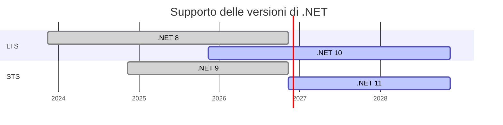

> In .NET la matematica è sempre stata la stessa. Erano i risultati a cambiare da un processore all'altro, e ora, in nome della correttezza, cambiano tra una versione e l'altra. In breve:
>
> 🧮 In C# lo stesso overflow ha **tre comportamenti diversi**: `int` ricomincia dal minimo, `double` arriva a **infinito**, `decimal` lancia **un'eccezione**.
>
> 🎯 Fino a .NET 8 convertire in `int` un `double` fuori intervallo dava `int.MinValue` su x86/x64 e un risultato diverso su ARM. Da **.NET 9** le conversioni **saturano** ovunque.
>
> 📏 **.NET 11** estende la saturazione a `byte`, `short` e `char`: `(short)65578.0` passa da **42** a **32.767**.
>
> 🔄 In .NET 11 `Math.Round(655.925, 2, MidpointRounding.AwayFromZero)` restituisce **655,92** invece di 655,93: il vecchio algoritmo sbagliava su circa il **5%** dei valori.
>
> 💶 `(decimal)1.23` oggi vale `1.229999999999999982236431606`, e **non c'è un interruttore** per tornare al comportamento precedente.
>
> 🔐 La sicurezza segue la stessa direzione: `BinaryFormatter` rimosso in .NET 9, crittografia **post-quantistica** in .NET 10, X25519 e HPKE in .NET 11.
>
> 📅 .NET 8 e .NET 9 sono **fuori supporto dal 10 novembre 2026**: chi aggiorna adesso eredita tutte queste modifiche in un colpo solo.

La matematica non è un'opinione. Il calcolo in virgola mobile, invece, un po' sì.

Il 10 novembre 2026 è uscito **.NET 11**, e lo stesso giorno .NET 8 e .NET 9 sono arrivati a fine supporto[^support_policy]. Chi aveva scelto .NET 8 perché era LTS adesso deve fare il salto, e molti scopriranno che alcuni conti non tornano più come prima.

Non perché .NET abbia iniziato a sbagliare. Perché ha smesso.

Negli ultimi tre rilasci Microsoft ha preso una serie di decisioni che vanno tutte nella stessa direzione: meno comportamenti "dipende dall'hardware", più risultati **deterministici e corretti**, anche se costano qualche ciclo di CPU e qualche breaking change. È la stessa direzione che il runtime ha preso sulla sicurezza.

Proviamo allora a capire, con un po' di ordine:

1. **perché** in un computer lo stesso conto può dare risultati diversi;
2. **cosa** è cambiato tra .NET 9 e .NET 11;
3. **come** aggiornare senza farsi sorprendere.

## Tre tipi, tre modi di sbagliare

C# ha tre famiglie di numeri non interi o "grandi", e ognuna sbaglia a modo suo.

I tipi **binari a virgola mobile** (`float`, `double` e `Half`) seguono lo standard **IEEE 754**: rappresentano i numeri come potenze di due. È per questo che `0.1 + 0.2` non fa `0.3` ma `0.30000000000000004`: né 0,1 né 0,2 hanno una rappresentazione binaria finita, così come 1/3 non ha una rappresentazione decimale finita. Il `double` più vicino a 0,1 è in realtà `0.1000000000000000055511151231257827…`.

Il tipo **`decimal`**, invece, lavora in **base 10**: 0,1 è davvero 0,1. Per questo è il tipo giusto per gli importi in euro. Ma è più lento, ha un intervallo molto più piccolo e non è "esatto" in assoluto: `1m / 3m` va comunque arrotondato.

La differenza più interessante, però, è come si comportano quando il risultato **non ci sta**. Per spiegarla uso il cruscotto di un'auto:

- gli **interi** (`int`, `long`…) sono il **contachilometri meccanico**: dopo 99.999 torna a 00.000. In un contesto `unchecked`, il default, `int.MaxValue + 1` diventa `int.MinValue` senza avvisare nessuno[^checked_unchecked];
- i **binari a virgola mobile** sono un display che, a fondo scala, mostra **`∞`**: un valore speciale che si può controllare, ma che si propaga silenziosamente in tutti i conti successivi, insieme al suo cugino **`NaN`** (*Not a Number*, il risultato per esempio di `0.0 / 0.0`);
- il **`decimal`** è la **spia rossa che spegne il motore**: lancia una `OverflowException` **sia** in contesto `checked` **sia** in `unchecked`[^checked_unchecked].

| Tipo | Cosa succede all'overflow |
|---|---|
| `int`, `long` (`unchecked`) | ricomincia dal valore opposto |
| `int`, `long` (`checked`) | `OverflowException` |
| `float`, `double`, `Half` | `±Infinity` |
| `decimal` | `OverflowException`, sempre |

E poi c'è il caso peggiore: il passaggio **da un tipo all'altro**. Che cosa deve fare `(int)1e10`, un `double` da dieci miliardi infilato in un intero che arriva a poco più di due miliardi? Il contachilometri non c'entra più: è il momento in cui il display del tachimetro deve decidere cosa scrivere su una lancetta che non arriva così in alto.

Fino a .NET 8 la specifica di C# rispondeva onestamente: in contesto `unchecked` *"il risultato è un valore non specificato del tipo di destinazione"*[^numeric_conversions]. Tradotto: **decide il processore**.

## Quando il risultato dipendeva dal processore

E i processori decidevano in modo diverso.

Su **x86 e x64** l'istruzione di conversione, quando il valore non ci sta, restituisce un **valore sentinella**: `0x80000000`, cioè `int.MinValue`. Quindi su un PC Intel o AMD `(int)1e10` faceva **-2.147.483.648**, un numero enorme e positivo diventato negativo. Su **ARM64** le istruzioni equivalenti invece **saturano**: il valore si ferma al massimo rappresentabile, **2.147.483.647**[^issue_61885].

Per i tipi senza segno era anche peggio: la tabella ufficiale del "prima" descrive per `uint` un'espressione a base di shift, `(((long)x << 32) >> 32)`, applicata a qualunque valore[^fp_to_int_net9].

Per anni è stato un problema teorico, perché quasi tutto girava su x64. Poi sono arrivati i portatili con processori ARM, i server Graviton e Ampere, i container multi-architettura. E una funzione poteva comportarsi in un modo sulla macchina dello sviluppatore e in un altro sul server di produzione o sul runner della CI.

Nel novembre 2021 un'issue nel repository `dotnet/runtime` ha proposto di smettere di "dipendere dalla piattaforma sottostante" e di **saturare sempre**, come facevano già ARM64, Rust e WebAssembly, convertendo `NaN` in **0**[^issue_61885]. La modifica è entrata in **.NET 9**, con questa motivazione ufficiale: *"standardizzare tutte le conversioni da virgola mobile a intero con un comportamento saturante e renderle deterministiche"*[^fp_to_int_net9].

Da .NET 9, quindi, su qualunque architettura:

- un valore **troppo grande** diventa il **massimo** del tipo di destinazione;
- un valore **troppo piccolo** diventa il **minimo** (0 per i tipi senza segno);
- **`NaN`** diventa **0**.

La correttezza ha un prezzo. Secondo le stime dell'issue originale, su un processore Skylake una conversione semplice passava da circa **7** a **19-24 cicli**[^issue_61885], perché x86 non ha un'istruzione che saturi da sola e il JIT deve aggiungere dei controlli. Per chi ha davvero bisogno di quei cicli esiste una via d'uscita esplicita, `double.ConvertToIntegerNative<TInteger>()`, che fa *"quello che è più efficiente per la piattaforma"* e non garantisce nulla fuori intervallo[^fp_to_int_net9]. Il punto è che ora la scorciatoia **va chiesta per nome**, non arriva di default.

## .NET 11 chiude il cerchio

.NET 9 aveva sistemato le conversioni verso `int`, `long`, `uint` e `ulong`. Restavano fuori i tipi piccoli, e .NET 11 sistema anche quelli, insieme a un paio di vecchi errori della libreria.

### Le conversioni verso i tipi piccoli

In .NET 11 anche le conversioni `unchecked` verso `sbyte`, `byte`, `short`, `ushort` e `char` **saturano**[^fp_small_int_net11]. L'esempio della documentazione Microsoft è perfetto per il titolo di questo articolo:

```csharp
static short ConvertValue(double value) => unchecked((short)value);

ConvertValue(65578.0); // prima: 42, da .NET 11: 32767
```

Prima il valore passava da un `int` intermedio, `65578` (`0x0001002A`), di cui si tenevano i 16 bit bassi: `0x002A`, cioè **42**[^fp_small_int_net11]. Un numero di sessantacinquemila e rotti diventava la risposta alla domanda fondamentale sulla vita, l'universo e tutto quanto. Ora diventa **32.767**, il massimo di uno `short`.

La modifica vale per CoreCLR (interprete compreso) e Native AOT, ma **non per Mono**[^fp_small_int_net11]: chi distribuisce lo stesso codice su runtime diversi deve tenerne conto.

### `Math.Round` che arrotonda davvero

Questo è il cambiamento che sorprenderà più persone. Fino a .NET 10 `Math.Round(value, digits, mode)` calcolava, in sostanza, `Round(value * 10^digits) / 10^digits`. Sembra ragionevole, ma la moltiplicazione introduce a sua volta un errore di arrotondamento.

```csharp
Math.Round(655.925, 2, MidpointRounding.AwayFromZero);
// fino a .NET 10: 655.93
// da .NET 11:    655.92
```

Il risultato "nuovo" sembra sbagliato, ma è quello giusto: il `double` più vicino a 655,925 è **655,92499999999995452…**, che sta **sotto** il punto medio, quindi l'arrotondamento corretto è 655,92[^math_round_net11]. Secondo Microsoft il vecchio algoritmo dava un risultato diverso da quello corretto per circa il **5%** dei valori casuali[^math_round_net11]. Una volta su venti.

Chi dipende dal vecchio risultato può riprodurlo scrivendo esplicitamente la moltiplicazione. Ma la vera lezione è un'altra, e la documentazione la dice senza giri di parole: per le valute si usa `decimal`.

### `decimal` e `double` si parlano correttamente

Anche la strada tra binario e decimale cambia. Fino a .NET 10 la conversione da `double` a `decimal` teneva solo **15 cifre significative** (7 per `float`). In .NET 11 il risultato è il `decimal` più vicino al valore **reale** del `double`[^decimal_conv_net11]:

```csharp
double value = 1.23;
decimal d = (decimal)value;
// fino a .NET 10: 1.23
// da .NET 11:    1.229999999999999982236431606
```

Il vecchio risultato era più bello, ma era **una bugia gentile**: il `double` scritto come `1.23` vale in realtà circa `1.2299999999999999822364316059975`, e il vecchio algoritmo buttava via informazioni che il `decimal` era perfettamente in grado di rappresentare[^decimal_conv_net11]. Lo stesso vale per le conversioni da `BigInteger` a `double`.

Qui Microsoft è stata netta: **non esiste un interruttore di compatibilità** per tornare all'algoritmo precedente[^decimal_conv_net11]. La raccomandazione è di non dare per scontato che `1.23` e `1.23m` siano lo stesso numero, e di scrivere direttamente i letterali `decimal` (`decimal prezzo = 1.23m;`) invece di passare da un `double`.

### Il resto della matematica di .NET 11

Le altre novità numeriche vanno nella stessa direzione:

- **`Decimal32`, `Decimal64` e `Decimal128`**: nuovi tipi che implementano la **virgola mobile decimale** dello standard IEEE 754-2019, con infiniti e `NaN`[^net11_libraries]. Non sostituiscono `decimal`: sono tipi diversi, pensati per l'interoperabilità con lo standard;
- **`Complex<T>`** generico, che funziona anche con `float`, `Half`, `BFloat16` e i nuovi tipi decimali[^net11_libraries];
- i **casi speciali dei numeri complessi** seguono ora l'Allegato G dello standard C23: dove prima uscivano due `NaN`, adesso escono infiniti con il segno corretto, e anche qui senza interruttore per tornare indietro[^complex_annex_g];
- formattazione e parsing in **esadecimale** dei numeri in virgola mobile (`Math.PI.ToString("X")` produce `0X1.921FB54442D18P+1`), utile proprio quando si vuole vedere il valore esatto di un `double` invece della sua versione abbellita[^net11_libraries];
- aritmetica su `Half` accelerata in hardware con **AVX10.1** su x64 e con le istruzioni FP16 su Arm64, senza modifiche al codice[^net11_runtime].

## Il filo rosso: niente "dipende"

Messe in fila, queste modifiche raccontano una scelta di campo. Per vent'anni la filosofia era: **il runtime fa quello che fa l'hardware**, e se l'hardware dà risultati diversi pazienza, tanto la specifica dice "non specificato". Da .NET 9 la filosofia è diventata: **il risultato deve essere uno solo**, su ogni processore, e deve essere quello matematicamente corretto, anche se costa.

Non è pignoleria. Un risultato che dipende dall'architettura è un risultato **non testabile**: i test che passano sul portatile non dimostrano nulla sul server. E un valore "non specificato" che finisce in una dimensione, in un indice o in un controllo di limite è esattamente il tipo di comportamento imprevisto da cui nascono molti bug, e una parte delle vulnerabilità.

La stessa filosofia si vede, in modo ancora più evidente, sulla sicurezza:

- **.NET 8**: supporto a **SHA-3** e, con `Vector512`, alle istruzioni AVX-512[^net8_runtime];
- **.NET 9**: **`BinaryFormatter` rimosso** dal runtime (le API restano, ma lanciano sempre un'eccezione), **KMAC** secondo NIST SP 800-185, **CET** (*Control-flow Enforcement Technology*, la protezione hardware contro il dirottamento del flusso di esecuzione) attivo di default su Windows[^net9_libraries][^net9_runtime];
- **.NET 10**: crittografia **post-quantistica** con **ML-KEM** (FIPS 203), **ML-DSA** (FIPS 204) e **SLH-DSA** (FIPS 205)[^net10_libraries];
- **.NET 11**: **X25519**, AES Key Wrap, una versione ibrida di ML-KEM e **HPKE** (*Hybrid Public Key Encryption*, ancora sperimentali), un limite di profondità di default per il parser CBOR e al massimo due download di certificati intermedi per catena su Linux[^net11_libraries][^breaking_net11].

È lo stesso movimento: togliere ciò che è comodo ma pericoloso (`BinaryFormatter` come le conversioni "non specificate"), mettere limiti di default dove prima non c'erano, e pretendere che ciò che il programmatore scrive faccia **una cosa sola**. In fondo è quello che il [Cyber Resilience Act](/post/2026-10-11-cyber-resilience-act-responsabilita-software-open-source/) chiede a chi produce software: prodotti sicuri **per impostazione predefinita**, non perché qualcuno si è ricordato di attivare l'opzione giusta.

Anche il codice gestito, del resto, non è immune da quello che succede sotto: nell'ottobre 2026 HTTP2Shell ha colpito anche .NET, attraverso la sua copia del decoder Brotli, come avevo raccontato parlando di [PHP2Shell](/post/2026-10-25-php-nel-2026-php2shell/).

## I limiti, detti chiaramente

Mi piace la direzione presa da .NET, ma ha dei costi che non vanno nascosti.

- **Le breaking change senza ritorno.** Per le conversioni `decimal` e per i numeri complessi non esiste un interruttore di compatibilità. È una scelta coerente, ma chi ha dati storici calcolati con il vecchio algoritmo (fatture, report, tabelle salvate) può ritrovarsi con differenze all'ultima cifra tra il prima e il dopo.
- **Il determinismo non è totale.** Mono resta fuori dalla saturazione dei tipi piccoli, e `ConvertToIntegerNative` è dichiaratamente dipendente dalla piattaforma. Chi lo usa per recuperare prestazioni si riporta in casa il problema originale.
- **Saturare non vuol dire avere ragione.** Dieci miliardi convertiti in `int` diventano 2.147.483.647: un numero prevedibile, ma **sbagliato** lo stesso. La saturazione rende il bug riproducibile, non lo corregge.
- **L'hardware.** .NET 11 alza il requisito minimo su x86/x64 al livello **x86-64-v2** (SSE4.2, POPCNT e affini) e sui processori più vecchi semplicemente non parte[^net11_hw]. Sono requisiti che Windows 11 chiede già, ma è comunque un altro pezzo di hardware funzionante che esce dal perimetro degli aggiornamenti.

## Aggiornare senza farsi sorprendere

Con .NET 8 e .NET 9 fuori supporto, le strade sono due: **.NET 10**, che è LTS, oppure **.NET 11**, che è STS. Un dettaglio che vale la pena notare: in questo giro **finiscono il supporto lo stesso giorno**, il 14 novembre 2028[^support_policy].



Chi passa da .NET 8 a .NET 11 attraversa in un colpo solo la saturazione di .NET 9 e le correzioni di .NET 11. Qualche consiglio pratico:

- **cercare nel codice** i cast da `float`/`double` a interi, le chiamate a `Math.Round` con il numero di cifre e i `(decimal)` applicati a un `double`: sono i punti in cui il risultato può cambiare;
- **rendere esplicita l'intenzione**: `checked(...)` se un valore fuori intervallo è un errore, `double.ConvertToInteger<T>()` se la saturazione è voluta, letterali `m` per gli importi;
- **test di regressione sui valori calcolati**: i casi limite (`NaN`, infiniti, valori a cavallo del punto medio, importi con molti decimali) vanno scritti come test, non lasciati al caso;
- **far girare la CI su più architetture**, almeno x64 e ARM64, se il software verrà eseguito su entrambe;
- **leggere la pagina delle breaking change** prima di aggiornare, non dopo: Microsoft le documenta bene, con il comportamento precedente, quello nuovo e la contromisura[^breaking_net11].

E se il software lo vendete, ricordate che il CRA chiede, salvo prodotti con una vita attesa più breve, almeno **cinque anni** di aggiornamenti di sicurezza, mentre una LTS di .NET ne dura **tre**. Nel periodo di assistenza di un prodotto, quindi, almeno un cambio di runtime è praticamente certo. Meglio che sia un aggiornamento di routine, con i test che fanno il loro lavoro, e non un salto nel buio fatto all'ultimo giorno di supporto.

## Fraintendimenti comuni

- ❌ **Anche i `decimal` saturano** → **Falso**. In caso di overflow, sia nei calcoli sia nelle conversioni verso un intero, `decimal` lancia sempre una `OverflowException`, anche in contesto `unchecked`. A saturare sono le conversioni da `float` e `double` verso gli interi.

- ❌ **`decimal` è esatto** → **Non necessariamente**. È esatto per i numeri decimali che rientrano nella sua precisione, come gli importi in euro. `1m / 3m` va comunque arrotondato.

- ❌ **La saturazione corregge l'overflow** → **Falso**. Lo rende prevedibile e uguale su ogni processore. Se un valore fuori intervallo è un errore, serve `checked`.

- ❌ **Se il test passa sul mio portatile, passa ovunque** → **Non necessariamente**. Con `ConvertToIntegerNative`, gli intrinsics hardware o Mono il risultato può ancora dipendere dalla piattaforma.

- ❌ **`Decimal128` sostituisce `decimal`** → **Falso**. Sono tipi diversi: `decimal` resta quello di sempre, i nuovi `Decimal32`, `Decimal64` e `Decimal128` seguono lo standard IEEE 754-2019, con infiniti e `NaN`.

- ❌ **.NET 8 è LTS, posso restarci tranquillo** → **Falso**. Il supporto è finito il 10 novembre 2026: niente più patch di sicurezza.

---

📚 **Fonti e approfondimenti**

[^support_policy]: Microsoft, [.NET and .NET Core Support Policy](https://dotnet.microsoft.com/en-us/platform/support/policy/dotnet-core).

[^checked_unchecked]: Microsoft Learn, [checked and unchecked statements (C# reference)](https://learn.microsoft.com/en-us/dotnet/csharp/language-reference/statements/checked-and-unchecked).

[^numeric_conversions]: Microsoft Learn, [Built-in numeric conversions (C# reference)](https://learn.microsoft.com/en-us/dotnet/csharp/language-reference/builtin-types/numeric-conversions).

[^issue_61885]: dotnet/runtime, [Update the runtime to have deterministic floating-point to integer conversions (#61885)](https://github.com/dotnet/runtime/issues/61885).

[^fp_to_int_net9]: Microsoft Learn, [Floating point-to-integer conversions are saturating](https://learn.microsoft.com/en-us/dotnet/core/compatibility/jit/9.0/fp-to-integer) (.NET 9).

[^fp_small_int_net11]: Microsoft Learn, [Floating-point conversions to small integral types are saturating](https://learn.microsoft.com/en-us/dotnet/core/compatibility/jit/11/fp-to-small-integer) (.NET 11).

[^math_round_net11]: Microsoft Learn, [Math.Round and MathF.Round return correctly rounded results](https://learn.microsoft.com/en-us/dotnet/core/compatibility/core-libraries/11/math-round-digits) (.NET 11).

[^decimal_conv_net11]: Microsoft Learn, [Decimal and BigInteger floating-point conversions are correctly rounded](https://learn.microsoft.com/en-us/dotnet/core/compatibility/core-libraries/11/decimal-biginteger-floating-point-conversions) (.NET 11).

[^complex_annex_g]: Microsoft Learn, [Complex special-value results follow C23 Annex G](https://learn.microsoft.com/en-us/dotnet/core/compatibility/core-libraries/11/complex-annex-g-special-values) (.NET 11).

[^net11_libraries]: Microsoft Learn, [What's new in .NET libraries for .NET 11](https://learn.microsoft.com/en-us/dotnet/core/whats-new/dotnet-11/libraries).

[^net11_runtime]: Microsoft Learn, [What's new in the .NET 11 runtime](https://learn.microsoft.com/en-us/dotnet/core/whats-new/dotnet-11/runtime).

[^net11_hw]: Microsoft Learn, [Minimum hardware requirements updated](https://learn.microsoft.com/en-us/dotnet/core/compatibility/jit/11/minimum-hardware-requirements) (.NET 11).

[^breaking_net11]: Microsoft Learn, [Breaking changes in .NET 11](https://learn.microsoft.com/en-us/dotnet/core/compatibility/11); .NET Blog, [Announcing .NET 11](https://devblogs.microsoft.com/dotnet/announcing-dotnet-11/).

[^net8_runtime]: Microsoft Learn, [What's new in the .NET 8 runtime](https://learn.microsoft.com/en-us/dotnet/core/whats-new/dotnet-8/runtime).

[^net9_libraries]: Microsoft Learn, [What's new in .NET libraries for .NET 9](https://learn.microsoft.com/en-us/dotnet/core/whats-new/dotnet-9/libraries).

[^net9_runtime]: Microsoft Learn, [What's new in the .NET 9 runtime](https://learn.microsoft.com/en-us/dotnet/core/whats-new/dotnet-9/runtime).

[^net10_libraries]: Microsoft Learn, [What's new in .NET libraries for .NET 10](https://learn.microsoft.com/en-us/dotnet/core/whats-new/dotnet-10/libraries).
